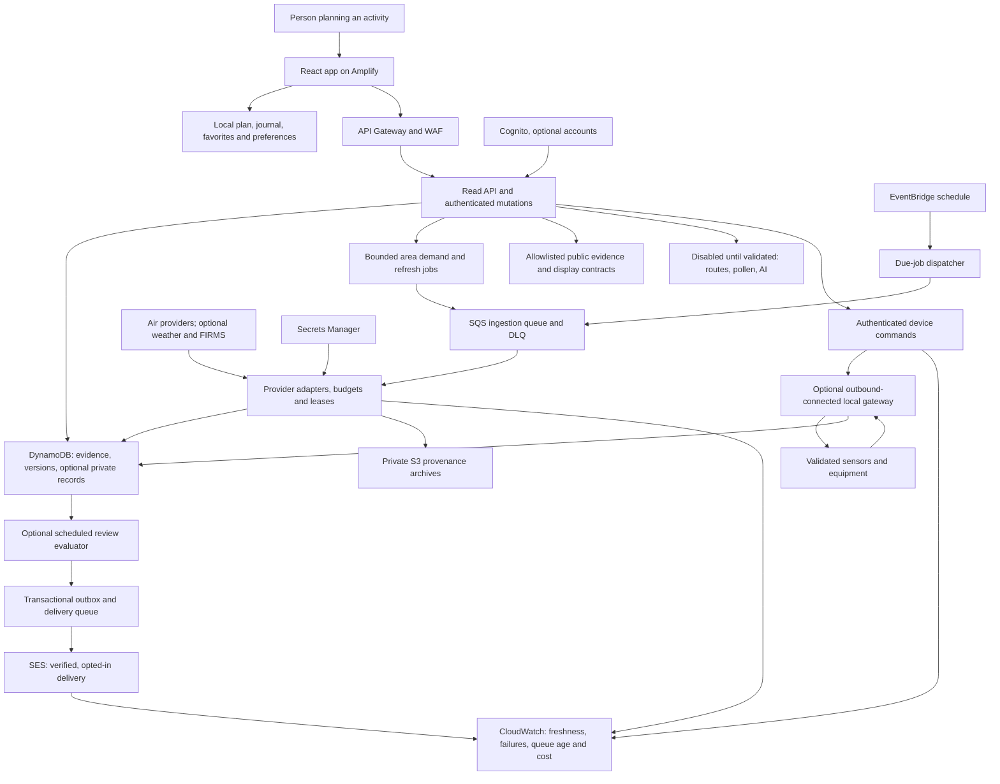

# Airday: complete feature implementation map

Prepared: **9 October 2026 (Asia/Kolkata)**, using the source review and repository baseline recorded on 8 October. Scope: **all 32 candidates, F01–F32**, from [FEATURE_RESEARCH.md](FEATURE_RESEARCH.md).

**Active scope, 10 October 2026:** finish the R0 foundations needed by R1 and R2 and verify all **16 R1/R2 features**. R3 work is paused; R4 and R5 are deferred. AWS deployment follows local acceptance. The full candidate map below is retained as historical planning context. [R0_R2_RELEASE_STATUS.md](R0_R2_RELEASE_STATUS.md) is the current scope and acceptance ledger. R1's 3–5 days plus R2's 5–10 days equals **8–15 estimated developer days**; including the separate R0 estimate gives **10–19 days**. These figures are estimates for the original extension work, not measured time spent or a forecast of remaining effort.

**Status, 9 October 2026: R1, R2 and R3 code integrated.** R1 covers F01/F02/F05/F08/F16/F17; R2 covers F03/F04/F07/F09/F10/F11/F12/F19/F20/F21; R3 covers F15/F14/F06/F13/F22/F23/F24 in that build order. See [IMPLEMENTATION_R1.md](IMPLEMENTATION_R1.md), [IMPLEMENTATION_R2.md](IMPLEMENTATION_R2.md) and [IMPLEMENTATION_R3.md](IMPLEMENTATION_R3.md) for behavior, bounds and outstanding verification. The latest offline suite passes **166 checks**, including 44 R3 cases and two new session/revocation cases. Local checks do not establish browser usability, production reliability or cloud deployment. Optional R3 integrations default off pending their external gates. R4/R5 and provider/hardware/evaluation gates remain tracked separately.

**10 October R3 browser update:** the authorized local rendered review is complete, including default gates, isolated synthetic enabled flows and 390-pixel emulation. Context failure labels and superseded-proposal approval controls were repaired and verified in the rebuilt app. See [R3_BROWSER_REVIEW.md](R3_BROWSER_REVIEW.md) for scope and screenshots; live integration and full device/accessibility gates remain open.

Frontend companion: [FRONTEND_UX_RESEARCH.md](FRONTEND_UX_RESEARCH.md) records the public-site visual/interaction review and 36 proposed experience improvements. [FRONTEND_UX_IMPLEMENTATION.md](FRONTEND_UX_IMPLEMENTATION.md) tracks UI implementation; R2 adds favorites, an optional station map and bounded history/period panels. External release verification remains required.

## 1. Product direction and existing foundation

Airday helps someone **plan an outdoor activity, understand the available evidence, choose a practical response, and review that choice when the evidence changes**. Schools remain the flagship demonstration; individuals, families and outdoor workers use the same planning engine. We measure reviewed activities and reported follow-through, with modeled comparisons labeled separately.

The implementation already contains:

- React/TypeScript dashboard, Indian place search/location selection, PM2.5/PM10 regional forecast, separate station cards, constrained timetable planning and a browser decision journal.
- Location/date/plan-scoped decisions, original and chosen assessments, reopen/supersede handling, atomic journal writes, independent provider status and guarded authentication requests.
- A Node API, bounded queued ingestion, provider quotas/cooldowns, cached evidence, prospective archives, policy review, optional organization approvals and approval email code.
- Deployment definitions/scripts for Amplify hosting, API Gateway/WAF, Lambda, SQS, EventBridge scheduling, DynamoDB, private S3 archives, Secrets Manager, Cognito, SES and CloudWatch. Cloud resources are **defined; deployment and cloud integration remain unverified**.

See [ARCHITECTURE.md](ARCHITECTURE.md), [RELEASE_STATUS.md](RELEASE_STATUS.md) and [WEBPAGE_AUDIT.md](WEBPAGE_AUDIT.md). The earlier integrity baseline had **120 passing offline checks**; the R3 implementation reran the complete suite with **166 passing checks**. Audit findings **1–6 and 18** have repairs; remaining audit verification stays in the backlog.

### Evidence rules for every addition

1. Preserve provider, pollutant, unit, interval/statistic, valid time, retrieval time, coordinates/grid resolution, quality flags and attribution.
2. Keep observations and model forecasts separate. Do not combine unlike stations, periods or providers into a supposed consensus value.
3. Missing data stays missing; zero is a valid concentration. Provider failure and retained-reading age are separate states.
4. A user-set planning threshold is not an official order or proof of safety. No official Indian AQI is derived by renaming PM concentration.
5. Decisions freeze the evidence reviewed at the time. New evidence creates a review requirement rather than rewriting history.
6. Sample/replay data is explicitly labeled and excluded from live production responses, alerts and device commands.
7. Coordinate lookup coverage is not proof of a nearby current station. Map density cannot establish street-level accuracy.

Open-Meteo documents the global model at approximately 45 km and three-hour source steps, with twelve-hour model updates; its pollen fields cover Europe. Those limits constrain route ranking, hyperlocal maps and Indian pollen features. [Air Quality API](https://open-meteo.com/en/docs/air-quality-api)

## 2. Release sequence

Every phase produces a usable release. Conditional modules stay off until their gates pass. Do not add empty feature panels to the main flow.

| Phase | Outcome                         | Features                                                                                                         | Dependency / release gate                                                         | Planning estimate for one developer                             |
| ----- | ------------------------------- | ---------------------------------------------------------------------------------------------------------------- | --------------------------------------------------------------------------------- | --------------------------------------------------------------- |
| R0    | Stable extension foundation     | Shared view models, contract validation, remaining relevant audit fixes, concurrency, recovery and feature flags | Preserve current integrity checks; storage migration and accessibility review     | 2–4 focused days; can be split into small repairs               |
| R1    | Complete activity decision loop | F01, F02, F05, F08, F16, F17                                                                                     | R0 changes affecting these flows; actual evidence states and export fidelity      | 3–5 days for the full bundle                                    |
| R2    | Personal evidence and history   | F03, F04, F07, F09, F10, F11, F12, F19, F20, F21                                                                 | R1; history contracts, map licensing, local-data controls                         | 5–10 days, delivered incrementally                              |
| R3    | Shared operations and context   | F06, F13, F14, F15, F22, F23, F24                                                                                | R1/R2 foundations; AWS deployment, provider/email/public-data gates as applicable | 5–10 days plus external setup                                   |
| R4    | Validated integrations          | F18, F25, F26, F27, F30, F31                                                                                     | Capability-specific licensed data, platform permissions and evaluation            | Scope each pilot separately; typically weeks plus approval time |
| R5    | Actual devices and controls     | F28, F29, F32                                                                                                    | Supported hardware, local gateway, tested operating policy and interlocks         | Separate hardware pilot; no fixed deadline before access        |

These are estimates for extensions, not a commitment to deliver 32 features in two days. Parallel tasks do not remove data, usability or hardware validation gates.

### The two-day hackathon cut

**Must finish:** F02 activity timeline + F01 quick best-time finder, the focused foundation fixes they require, honest live/degraded states, and a working AWS release if sign-in is completed. Preserve station cards when a map is not ready. Keep a forecast-only release usable when a monitor feed is absent.

**Next, only after the core works:** F05 in-app review alerts, F08 printable evidence report, F17 clear bilingual explanations and F16 understandable source status. F03 station map is the first visual extension after the release is stable; it must not delay deployment or the recorded demo.

| Day            | Work order                                                                                                             | Tangible result                                                                               |
| -------------- | ---------------------------------------------------------------------------------------------------------------------- | --------------------------------------------------------------------------------------------- |
| 1, first half  | Add one activity view model; fix date/activity summary context and feasible alternatives; build the F02 timeline       | A user sees a dated activity, its evidence, a review reason and the current decision          |
| 1, second half | Add F01 duration/allowed-hours form; connect result selection to the same journal and timeline                         | Search → complete alternative → record choice → reload with the same evidence and chosen time |
| 2, first half  | Complete integrity/accessibility verification; add F05/F08 if time allows; finish deployment configuration and runbook | Changes trigger re-review; the dated record can be shared through an honest report            |
| 2, second half | Connect available secrets, deploy, verify HTTPS and real source behavior; record three-minute demonstration            | Deployed working flow and recorded proof of AWS use; remaining gates recorded explicitly      |

If AWS access remains unavailable, finish the local flow and deployment artifact first, then report that deployment is pending. Use AWS SAM locally for the AWS open-source path only if it is actually exercised and shown. No simulated deployment claim.

## 3. Target architecture

Extend the current serverless architecture. Keep expensive or externally gated branches disabled until selected.

The current repository already implements the central API/cache/ingestion path and organization approval notifications. The generic alert evaluator/outbox, public integrations and device branch are **new work**. The diagram does not prescribe a Lambda function per feature; related bounded operations can share a function until isolation, latency or permissions justify separation.

### Local and AWS equivalents

| Concern          | Local development                                                           | AWS release                                                         |
| ---------------- | --------------------------------------------------------------------------- | ------------------------------------------------------------------- |
| UI               | Existing Vite dev server                                                    | Existing Amplify static hosting/HTTPS                               |
| API              | `api/local-server.mjs` with the same contracts                              | Existing API Gateway + read Lambda                                  |
| Ingestion        | Bounded local job loop and FileStore                                        | Existing dispatcher + SQS + ingest Lambda                           |
| Durable evidence | Existing atomic FileStore; MemoryStore only for explicit fixtures           | DynamoDB with conditional writes, TTL and PITR                      |
| Archives         | Existing private local gzip archive                                         | Existing private S3 archive; lifecycle/versioning                   |
| Alerts/email     | Local evaluator and an explicitly labeled delivery log; no fake sent status | Scheduled evaluator, outbox/SQS, SES and delivery status            |
| Maps             | Same licensed tile configuration and station adapter                        | Same; constrain tile key/domain and comply with provider terms      |
| Devices          | Owner's gateway + actual device integration                                 | Optional device gateway/IoT path; no public Home Assistant exposure |

Do not introduce EC2, EKS, RDS or a NAT Gateway for the base release. The existing services are sufficient for a bounded pilot.

## 4. User interface map

### Primary navigation

- **Today:** confirmed location, today/tomorrow switch, activity timeline, quick-time search and actionable review alerts. Keep source freshness beside the suggestion.
- **Plan:** recurring activities, duration, allowed hours, flexibility, indoor option confirmation and user-set thresholds. Include school/walk/work templates with editable example values.
- **Evidence:** forecast chart, independent monitor cards, optional station map, source details and additional pollutant/weather tabs when supported.
- **History:** dated decisions, original/chosen times, frozen reasons/evidence, follow-through, trends, recaps and reports.
- **Settings:** language, favorites, notifications, local-data export/delete/recovery. Optional workspace and device setup appears only when enabled.

On phones, keep the main decision action reachable without scrolling through multiple evidence panels. Every chart/map has a readable table/list alternative. Preserve location search when geolocation is denied; detect location only after a clear user action and confirmation. Do not continuously track someone using the location-selection button.

### Canonical activity status

Use one derived view model for the headline, timeline, editor, alerts, summary and report:

`not_reviewed → recorded_current → needs_recheck → recorded_current`

Reopening explicitly makes the activity unresolved. Superseded records remain in history. A passed activity can be reviewed retrospectively or have follow-through recorded, but cannot be rescheduled into the past. These are **UI states derived from the existing journal**, not permission to replace its lifecycle/provenance fields.

Show separate labels for **no usable evidence**, **forecast only**, **fresh observation available**, **stale retained observation**, **provider failed**, and **sample/replay**. A recorded action can still need another review after a material evidence change. The user chooses the response; the app does not issue a school closure order.

## 5. Engineering work packages and file map

Paths below are repository-relative. **Existing** files are extension points; **new** paths are proposed. Keep changes small and feature-specific, with a working vertical flow after each package.

### W01 — Local persistence, recovery and concurrency

**Existing:** `src/lib/storage.ts`, `src/lib/decision-state.ts`, `src/lib/decision-evidence.ts`, `src/App.tsx`.

**Proposed:** `src/lib/localRepository.ts`, `src/lib/localMigrations.ts`, `src/hooks/useLocalPlan.ts`.

- Introduce a repository interface so the UI no longer relies on scattered direct storage writes. Keep current journal schema 3 readable.
- For the durable extension, migrate the plan/journal/preferences/favorites into transactional IndexedDB stores with a database schema version, record revisions and expected-revision writes. Preserve the legacy document as a recovery copy until successful migration. Do not operate two active writers against different canonical stores.
- Validate every migrated record and its frozen evidence. Unknown versions/corrupt bytes are recoverable errors, not an empty journal that overwrites the original.
- Use one transaction for related mutations; on stale revision, reject with a conflict/reload choice. Cross-tab messages refresh views; transactions provide write integrity. Broadcast messages alone are not a lock.
- If IndexedDB is unavailable, show explicit session-only mode and export/recovery options; never claim persistence succeeded. An interim R1 patch can coordinate legacy writes with a supported browser lock, but must not claim conflict-free writes on unsupported browsers.
- Provide versioned local export/import with a preview, bounds, validation and an explicit merge/replace choice. Clear only Airday-owned data. Exact detected location is not a necessary field in the retained decision history.

**Done:** interrupted migration preserves old bytes; concurrent tabs cannot silently overwrite a revision; failed writes/reloads preserve decision/evidence pairing. Resolves audit 31/35 and retains 1–6.

### W02 — One planning and activity domain

**Existing:** `src/lib/planner.ts`, `src/lib/decision-evidence.ts`, `src/lib/decision-state.ts`, `src/lib/summary.ts`, `api/workspaces.mjs`.

**Proposed:** `src/lib/activity-view.ts`, `src/lib/time-search.ts`, `src/lib/exposure.ts`, `src/lib/periods.ts`.

- Derive a dated activity view from location + plan version + journal + selected date + evidence snapshot + current clock.
- Share assessment rules across the timeline, chosen-window review, alerts, export and server approvals. Extract a pure portable core where needed; retain the existing client/server parity checks during migration.
- Define allowed start/end, duration, flexible/fixed flag, excluded blocks and time resolution. Rank complete feasible windows by PM2.5 peak first, then lower mean, then time; explain the statistic. Do not silently switch the current peak-based threshold to an average.
- Show no feasible alternative when constraints exclude all windows. Do not suppress a valid window merely because its start precedes the original start. Require a new, unchecked confirmation for indoor suitability.
- Freeze original/chosen assessments, evidence identifiers and settings at record time. Summaries and exports refer to that dated record, not today's mutable timetable.
- Concentration-time estimates use explicit interpolation and interval overlap, not sums of arbitrary API samples. Never interpolate across missing values without a documented rule; exclude incomplete windows from comparative ranking.

**Done:** all surfaces agree about the same activity; constraints, location switches and evidence changes behave identically. Resolves audit 8–15/28 and preserves earlier regressions.

### W03 — UI modules, localization and accessible interactions

**Existing:** `src/App.tsx`, `src/App.css`, `src/index.css`, `src/components/PlanEditor.tsx`, `DecisionEditor.tsx`, `DecisionSummary.tsx`, `WorkspacePanel.tsx`, `ForecastChart.tsx`.

**Proposed:** `src/hooks/useEvidence.ts`, `useReviewAlerts.ts`, `useWorkspace.ts`; `src/components/ActivityTimeline.tsx`, `QuickTimeFinder.tsx`, `ReviewAlertList.tsx`, `EvidenceStatus.tsx`, `GuidanceCard.tsx`, `HistoryView.tsx`, `AppErrorBoundary.tsx`; `src/i18n/en.ts`, `hi.ts`.

- Split evidence fetching, local planning, journal mutations and authenticated workspace state into separate controllers with abort/generation guards. Keep selection/date changes scoped.
- Separate choosing an action from opening its editor. Associate errors with the affected field; retain drafts after a recoverable error. Make discard, retry, dismiss and Undo keyboard discoverable with deliberate focus restoration.
- Translate forms, validation, source states, date/time labels, recorded actions and guidance into English/Hindi. Keep provider/station names faithful to the source.
- Display isolated chart points, real loading versus unavailable states, effective chosen-time previews and recoverable rendering errors. Validate responses before using them.
- Use local/system fonts and clear nontechnical wording. Target WCAG 2.2 AA, including contrast, zoom/reflow, focus, input labels, keyboard dialogs and non-color status cues.

**Done:** a person can complete the whole flow on a phone and keyboard in either supported language. Addresses audit 7, 21–30, 32–34; workspace recovery is also W07.

### W04 — Contracts, capabilities and provider extensibility

**Existing:** `src/types.ts`, `api/handler.mjs`, `api/core.mjs`, `api/providers.mjs`, `api/transport.mjs`, `api/engine.mjs`, `api/services.mjs`.

**Proposed:** `shared/contracts/`, `api/capabilities.mjs`, `api/providers/weather.mjs`, `fires.mjs`; client response validators.

- Define a versioned pollutant-series envelope supporting PM2.5, PM10 and documented gases, while retaining a v2 adapter for existing dashboard consumers. Use explicit schema negotiation for breaking changes; never silently change a field's units/type.
- Add provider metadata/capability status: disabled, not configured, unverified, available, degraded, no coverage. The UI shows features only when both enabled and usable for the requested location/date.
- Treat weather/fire/pollen/device feeds as separate evidence families. Add independent schedules, quotas, ingestion status, archives and validation.
- Keep HTTPS upstream host allowlists, redirect rejection, response-size/time limits and secret redaction. User input cannot specify an upstream URL.
- Cache by actual provider/model grid or catalog where valid; an app's 0.1-degree admission cell is not the model's spatial resolution.

**Done:** malformed arrays, missing units, future timestamps, invalid coordinates and mixed schema versions cannot become plausible UI readings.

### W05 — Bounded history, reports and personal metrics

**Existing:** `api/store.mjs`, `api/engine.mjs`, `api/evaluation.mjs`, `src/lib/summary.ts`, existing journal/archive export paths.

**Proposed:** `api/history.mjs`, `api/reports.mjs`, `src/lib/report.ts`, `src/lib/recap.ts`, `src/components/TrendChart.tsx`, `ReportView.tsx`.

- Add range queries and opaque pagination cursors to Memory/File/Dynamo stores. Reuse the existing `Timeline` index for supported decision access; introduce explicit evidence-series keys for historical reads. Do not scan the table or return an unbounded journal.
- Index normalized hourly/interval data for chart reads. Keep immutable raw/provenance archives separate; browsing a chart must not decompress an entire archive collection.
- Use archived forecast-as-issued series and observed series independently. Label retrieved retrospective history differently from forecasts actually shown before an event.
- Include period completeness, source/interval/unit and quality flags in comparisons. Show the actual retained range and gaps; do not fabricate history before retention began.
- CSV neutralizes spreadsheet formula injection; print reports include frozen date/plan/evidence/actions. Preview private fields and default to omitting personal coordinates/reasons from shared/public reports.
- Recaps/progress distinguish scheduled minutes, user-reported completed minutes, recorded choices and modeled concentration-time estimates. No diagnosis, proprietary health score or guaranteed exposure saving.

**Done:** exports match history after later edits; paging and downsampling preserve extrema/gaps; personal metrics do not double-count superseded records.

### W06 — Maps and favorites

**Existing:** station coordinates in `src/types.ts`, `api/spatial.mjs`, location selection in `src/App.tsx`, existing returned coverage.

**Proposed:** `src/components/StationMap.tsx`, `StationList.tsx`, `FavoritePlaces.tsx`, `src/lib/map-provider.ts`.

- Select a maintained map library and a permitted tile service; record license, attribution, key restrictions, quotas and location disclosure. Do not assume public OpenStreetMap tiles permit arbitrary production traffic/offline downloads.
- Plot station points with evidence tooltips and an accessible synchronized list. Distinguish model grid from selected place; fit only validated coordinates. Missing coordinates stay in the list.
- Load the map on demand; keep planning usable if tiles fail. Exact GPS is optional, consented and unnecessary to publish.
- Start with five browser-local favorite places, editable names and scoped histories. Switching a favorite loads only the selected area; bookmarking must not enqueue every favorite at every refresh.

**Done:** unavailable tiles/coordinates do not block decisions, old-place responses cannot replace the selected context, and favorites respect the existing 20-active-area pilot cap.

### W07 — Shared workflows, notifications and organization groups

**Existing:** `api/workspaces.mjs`, `api/notifications.mjs`, `api/store.mjs`, `src/lib/auth.ts`, `src/lib/requestScope.ts`, `src/components/WorkspacePanel.tsx`, `template.yaml`.

**Proposed:** `api/subscriptions.mjs`, `api/review-alerts.mjs`, `api/outbox.mjs`, `api/alert-dispatcher.mjs`, `api/delivery-events.mjs`, `src/components/NotificationSettings.tsx`, `GroupView.tsx`.

- Refine per-record submission, pending/reopened/superseded proposal lifecycle, optimistic conflicts and review/approval history. A committed mutation followed by a failed reload must say "saved; refresh failed" and offer recovery.
- Enforce server-side organization membership/role on every record; do not trust a browser-supplied tenant/approver. Review the current chosen window/evidence before approval.
- Browser-local plans are not available to a closed-tab cloud scheduler. For background emails, require explicit consent to sync a minimal plan/threshold/coarse place plus verified destination; use authenticated preferences for the initial release. Guest in-app alerts remain account-free.
- Use idempotent change events, a transactional outbox, leases and bounded due-time queries. Separate review alerts from existing approved-decision emails; share delivery infrastructure only through explicit job types.
- Deduplicate by subscriber + activity/date + material assessment transition. Do not alert on every small model update. Re-check opt-in, evidence state, quiet hours and latest decision before sending.
- Use one-use destination-verification tokens and signed unsubscribe tokens with expiry/rotation. Make unsubscribe available without sign-in; suppress bounced/complaining recipients. Disable tracking pixels.
- Maintain delivery states: pending, accepted by SES, delivered if confirmed, failed, suppressed, unknown. An uncertain send is not blindly retried; acceptance is not proof of receipt. Show queued changes on the next visit when delivery fails.

**Done:** two organizations cannot access each other's records; duplicate jobs do not intentionally resend; sign-out cannot resurrect pending data; closed-tab emails use only explicitly synced plans. Addresses audit 16–17/19–20 alongside the existing 18 repair.

### W08 — Offline, public displays and bounded integrations

**Existing:** current API/CSP/hosting configuration, `src/main.tsx`, `api/handler.mjs`, `template.yaml`, deployment script.

**Proposed:** `src/service-worker.ts`, install manifest, `src/components/PublicDisplay.tsx`, `api/public-evidence.mjs`, widget entry point and integration contract documentation.

- Cache the shell and explicitly chosen public coarse evidence for offline reading. Label cache age, last refresh, unavailable sources and offline status. Exclude authenticated API responses, tokens, device data and private journals from shared service-worker caches.
- Local offline decisions remain recorded against their frozen old evidence and visibly require online recheck before cloud approval/delivery. Never claim a live alert or real-time device control while offline.
- Update the service worker with compatible schema/build rules; preserve unsaved drafts and storage migration safeguards. Include clear cached-data deletion.
- Public displays/API responses use allowlisted fields only: public place/grid, sources, observations, timestamps and general guidance. No private timetable, reasons, email, membership or exact detected GPS.
- Use a dedicated widget route/build with reviewed framing/CSP and approved embed origins. Preserve the main application's frame protection; do not allow arbitrary HTML or unrestricted iframe access.
- Give public evidence bounded area/date parameters, documented versioning, quotas and provider attribution/redistribution rules. Partner/private endpoints require separate scoped authorization; CORS does not replace it.

**Done:** a public URL/widget cannot expose organization/local records; offline data cannot look current; updating the app does not destroy a draft/journal.

### W09 — Optional AI, feedback and guidance

**Existing:** deterministic assessment/summary and reviewed policy source registry.

**Proposed:** `api/explanations.mjs`, `api/feedback.mjs`, `src/lib/guidance.ts`, `src/components/ExplanationPanel.tsx`, `SuggestionFeedback.tsx`.

- Ship reviewed English/Hindi templates first. Bind explanations to an assessment and snapshot; show rule/source date and feasible alternatives.
- AI receives a minimal structured computed assessment plus approved source excerpts; exclude precise location, private reasons and child/student records. Do not allow it to change rules, approve a decision or control a device.
- Validate bounded structured output and citation identifiers against the supplied source set. If generated text conflicts with the deterministic state, omit it and use the template. Treat external text as untrusted data, not instructions.
- Require explicit use of the explanation assistant, per-user/global quotas, model/region/cost checks and a template fallback. No arbitrary web browsing, tool execution or upstream URL ingestion.
- Feedback starts locally: useful/not useful plus a bounded reason enum and optional short text. Sending feedback to a cloud service is explicit and privacy explained. Keep progress private.

**Done:** provider/model outage leaves the planner working; output cannot invent a cited order; feedback cannot execute HTML or inject report formulas.

### W10 — Routes, journeys, wearables, pollen and fine-resolution pilots

**Proposed:** `api/routes.mjs`, `api/providers/routing.mjs`, `fine-air.mjs`, `pollen.mjs`; `src/components/RouteComparison.tsx`, `JourneyRecorder.tsx`; `src/lib/track.ts`, `gpx.ts`; chosen platform adapter.

- Begin with a technical/data trial in one Delhi NCR corridor: permitted route geometries, supported travel modes, temporal/spatial coverage, retrieval limits, source rights and out-of-sample plausibility checks.
- Compare a maximum of three legal alternatives, matching departure time/travel assumptions. Show duration/distance alongside modeled air differences and missing segments. Require sufficiently resolving evidence and a defensible uncertainty/comparability criterion before ranking a "lower modeled exposure" route.
- Regional 45-km forecasts alone do not resolve nearby streets. If paths share unresolved model cells or differences are unsupported, show timing/travel alternatives without a pollution ranking. Ambee advertises 5-km data and sub-kilometer data on request; actual access/Delhi suitability are a contract and pilot gate. [Ambee Air Quality](https://www.getambee.com/api/air-quality)
- Foreground GPS tracking is opt-in with visible start/stop, accuracy/gap information and interruption recovery. GPX import is local-first with size/point/date bounds, no external entity resolution and no remote URLs. Do not upload a full route by default.
- Wearables require a selected documented platform/OAuth flow, narrow scopes, secure token storage/refresh/revoke and export/delete. Native Apple Health/Health Connect work is a separate mobile scope.
- Indian pollen requires a verified feed, taxa, units, update cadence and geographic/time coverage. Fine-resolution hotspot/dispersion maps require validated observations/model uncertainty and a reproducible evaluation. Wind arrows and fire points alone do not identify a pollution source.

**Done:** no supported data means no pollution ranking; GPS interruptions do not invent journeys; revoked imports stop; maps do not falsely interpolate sparse stations.

### W11 — Sensor and equipment integration

**Proposed:** `api/devices.mjs`, `api/device-commands.mjs`, `api/providers/indoor.mjs`, `gateway/`, `src/components/IndoorEvidence.tsx`, `DeviceControls.tsx`, device operating-policy configuration.

- Integrate one documented supported device through an owner-controlled gateway. Use outbound TLS with scoped credentials/certificates; authenticate tenant/device ownership, rotate/revoke credentials and audit commands. No arbitrary IP/URL proxy from the cloud API.
- Record pollutant/units/time/placement/quality/calibration independently from outdoor model/station data. An indoor sensor's value is not a regulatory reference measurement unless independently established.
- Start with manual purifier controls: desired state, command ID, expiry, idempotency, acknowledgment and observed state. A command accepted by the API is not proof the purifier changed state.
- Add explicit opt-in automation only after actual hardware checks. Require fresh indoor PM, separate start/stop thresholds, minimum cycle times, manual override and recorded operating policy. Missing/stale evidence stops new automatic decisions; device behavior during disconnection must follow the owner-approved policy, not an assumed universal off command.
- Ventilation needs suitable indoor/outdoor readings and operating interlocks; dust suppression needs site equipment/sensors/operator approval. Validate water/electrical/mechanical constraints before a control pilot. Public viewers cannot issue commands.

Home Assistant documents actual service calls separately from setting a state representation; use a supported service integration and confirm the observed entity state. [REST API](https://developers.home-assistant.io/docs/api/rest/)

**Done:** expired/duplicate/unauthorized commands cannot actuate equipment; observed state and override remain visible; offline/stale data cannot trigger uncontrolled cycling. F32 stays outside the consumer/school release until a site pilot passes.

### W12 — Release, operations and capacity

**Existing:** `template.yaml`, `scripts/build-api.mjs`, `deploy-aws.ps1`, `check-infra.mjs`, `security-check.mjs`, `operator.mjs`, `preflight.mjs`, current test files.

**Proposed:** feature configuration, deployment/migration manifest, rollback/runbook updates and only the workers/IAM resources required by the enabled phase.

- Add new entry points to the API build/local dispatcher and SAM only when needed. Configure identical job schemas locally/cloud; reject unknown job types.
- Add capability flags and kill switches separately for new ingestion, email, AI, route lookup and device automation. UI visibility is derived from server capabilities; secrets never enter `VITE_*` or a frontend bundle.
- Instrument public-read latency, forecast/observation age, successful attempts, invalid records, area admission, job age/retries/DLQ, alert suppression, delivery state and device acknowledgments. Log identifiers/error classes without exact GPS, tokens or private free text.
- Extend deploy/preflight for migrations, CORS/CSP, provider rights, verified destination, per-function IAM and enabled-feature limits. Distinguish code checks, authenticated-provider checks, rendered usability, actual cloud behavior and field validation in release evidence.
- Roll out by one pilot/area and a feature flag; retain a last-known compatible build and store backup. Rollback cannot silently revert a migrated schema to an incompatible writer.

**Done:** a new feature can be disabled without losing the core planner; cloud restore and documented incident recovery have actual drill evidence before broad shipping.

## 6. Every feature: dependency, implementation and acceptance

Work-package references identify the file changes above. A dependency means its underlying capability is required; its entire screen need not be shipped first. Every listed endpoint in section 8 is **proposed Airday API work**, except those explicitly marked existing.

### R1 — The decision loop

| ID      | User-visible addition            | Implementation / dependencies                                                                                  | Acceptance and failure behavior                                                                                                                                                            |
| ------- | -------------------------------- | -------------------------------------------------------------------------------------------------------------- | ------------------------------------------------------------------------------------------------------------------------------------------------------------------------------------------ |
| **F01** | Quick best-time finder           | W02/W03; duration + allowed times form, pure window ranking, current forecast, optional save as dated activity | Results respect duration/excluded times/date and complete coverage; selecting one records its actual window; no usable alternative has an explicit reason                                  |
| **F02** | Activity timeline and templates  | W01–W03; existing recurring plan/journal → dated view; school/walk/commute/work templates                      | Recorded current action resolves that review count; reopening/crossing makes it unresolved; history, chosen time and follow-through are accessible without changing current plan           |
| **F05** | Smart in-app review alerts       | W02/W03; F02 identity/status; persist dismissal against material-transition signature                          | One alert per meaningful transition; stale/no-coverage alerts are distinguishable from threshold crossings; no closed-tab delivery promise; prior dismissal does not hide a new transition |
| **F08** | CSV and printable report         | W05; F02 dated frozen record, export preview/print stylesheet                                                  | Original/chosen window, units, source/time/coverage/action/reason survive later plan edits; absent data prints honestly; private fields are opt-in; formula-prefixed text is neutralized   |
| **F16** | Evidence service health          | W03/W04/W12; separate attempt/success and observation age; operator diagnostics                                | A feed can show failed retrieval plus an old retained reading simultaneously; guest view never reveals keys/internal logs; operator receives actionable stale/queue warnings               |
| **F17** | Practical English/Hindi guidance | W02/W03/W09; deterministic reviewed templates, plan alternatives and source dates                              | Guidance agrees with the computed rule, explains limits and feasible choices; no diagnosis/official order; unsupported policy stays verification-needed                                    |

### R2 — Personal evidence and history

| ID      | User-visible addition         | Implementation / dependencies                                                              | Acceptance and failure behavior                                                                                                                                                   |
| ------- | ----------------------------- | ------------------------------------------------------------------------------------------ | --------------------------------------------------------------------------------------------------------------------------------------------------------------------------------- |
| **F03** | Nearby-station map            | W04/W06; station catalog/coordinates and approved tile license; independent of F25 routing | Correct station/source/distance/time/quality; no inferred heatmap; missing coordinates and tile outages retain an accessible station list                                         |
| **F04** | Favorite places               | W01/W06; five local favorites, selected-area load; F02 context scoping                     | Switch/reload/delete retains each place's correct history; late old-place response is ignored; admission/queue budget stays bounded                                               |
| **F07** | Historical trends             | W04/W05; retained series + history reconciliation/archives; new bounded history API        | Observations versus model-as-issued remain separate; only actual retained dates shown; missing periods visible; paging and source changes are explicit                            |
| **F09** | Daily/weekly recap            | W02/W05; F02 dated records/follow-through; F07 where modeled series are used               | Scheduled versus reported minutes/actions distinguished; reopened/superseded records not double-counted; no history produces an honest empty view                                 |
| **F10** | Concentration-time estimate   | W02/W05; complete forecast/compatible interval integration, F01/F02 windows                | Values labeled in concentration × time units with model/coverage assumptions; no invented indoor dose, physiology or health result; incomplete comparisons withheld               |
| **F11** | Additional pollutant tabs     | W03/W04; new pollutant-series contract/provider fields for NO2/O3/SO2/CO                   | Each series has unit/source/period and null handling; PM planning rule unchanged unless a user explicitly configures a supported additional rule                                  |
| **F12** | Period/parameter comparisons  | W02/W05; F07/F11 or compatible interval observations; overlap-weighted averages            | 1/8/24-hour views show completeness and included intervals; incompatible sources/statistics are not averaged; no automatic official AQI claim                                     |
| **F19** | Suggestion feedback           | W01/W09; assessment/decision ID and local bounded feedback, optional opted-in cloud POST   | Useful/not useful + practical reason survives reload; free text bounded/escaped; no duplicate submit or silent cloud upload                                                       |
| **F20** | Private personal progress     | W02/W05; F02/F09 metrics; local by default                                                 | Counts match journal/follow-through and selected range; user can clear/export; no public leaderboard or unvalidated health/exposure score                                         |
| **F21** | Installable/offline read view | W01/W08/W12; app shell, versioned coarse evidence cache                                    | No network still shows explicitly aged retained evidence; reconnect reassesses; private API responses are not cached by the service worker; storage/build updates preserve drafts |

### R3 — Shared operations and context

**Code implemented:** F15 → F14 → F06 → F13 → F22 → F23 → F24. See [IMPLEMENTATION_R3.md](IMPLEMENTATION_R3.md) for the actual UI/routes, atomic workflow/outbox recovery, pilot quotas, flags and release gates. The local rendered review is recorded in [R3_BROWSER_REVIEW.md](R3_BROWSER_REVIEW.md); the acceptance criteria below still require applicable live integration and full manual device/accessibility verification.

| ID      | User-visible addition           | Implementation / dependencies                                                                   | Acceptance and failure behavior                                                                                                                                                                            |
| ------- | ------------------------------- | ----------------------------------------------------------------------------------------------- | ---------------------------------------------------------------------------------------------------------------------------------------------------------------------------------------------------------- |
| **F06** | Opt-in email alerts/daily brief | W02/W07/W12; F05 evaluator, minimal opted-in cloud plan, verified destination, SES setup        | Correct IST day/quiet hours, deduplication, unsubscribe/bounce suppression and evidence time; opt-out before send prevents delivery; unknown delivery is not claimed successful                            |
| **F13** | Public display mode             | W03/W08; public projection, large text, visible age/source, QR/public route                     | Unauthenticated view shows only permitted coarse public evidence; expired/offline state stays visible; no private timetable, reasons or detected GPS                                                       |
| **F14** | Site/area groups                | W01/W06/W07; F04 local groups first, F15 membership for shared groups                           | Group switching preserves place context; quotas count admitted areas; members cannot read another organization; comparisons do not imply campus measurements                                               |
| **F15** | Shared responsibilities         | W02/W03/W07/W12; refine existing Cognito/workspace flows                                        | Any eligible record can be proposed; conflicts/reopening/revocation are visible; server recomputes current chosen-window approval eligibility; committed-save/read-failure recovery works                  |
| **F22** | Public API/display integration  | W04/W08/W12; F13 allowlisted projection, source redistribution rights, partner scopes           | Versioned bounded API/widget with attribution; no arbitrary provider URL; forbidden fields/tenants cannot be accessed; rate limits and tile/iframe failures are documented                                 |
| **F23** | Weather context                 | W03/W04; documented Open-Meteo weather fields, separate cached ingestion                        | Temperature/apparent temperature/humidity/rain/wind have valid times/units; weather failure does not erase air; cooler/drier suggestions use separate explicit rules, not an official heatwave declaration |
| **F24** | Recent satellite-fire map       | W04/W06/W12; F03 map infrastructure, FIRMS key/feed, deduplicated bounded region/time ingestion | Satellite acquisition time/source/confidence visible; delayed/no detections distinct from no fire; wind context labeled; no claim of stubble identity or caused Delhi pollution                            |

Weather fields are documented separately by the [Open-Meteo Weather API](https://open-meteo.com/en/docs). FIRMS provides documented area retrieval and requires a MAP_KEY; choose a currently supported NOAA-20/21 feed and verify quota/product availability at setup. Satellite acquisition is not continuous observation. [FIRMS API guide](https://firms.modaps.eosdis.nasa.gov/content/academy/data_api/firms_api_use.html), [key/quota page](https://firms.modaps.eosdis.nasa.gov/api/map_key/)

### R4 — Conditional data/platform integrations

| ID      | User-visible addition            | Implementation / dependencies                                                                    | Acceptance and release gate                                                                                                                                               |
| ------- | -------------------------------- | ------------------------------------------------------------------------------------------------ | ------------------------------------------------------------------------------------------------------------------------------------------------------------------------- |
| **F18** | Optional explanation assistant   | W09/W12; F17 deterministic fallback, selected model/region/access/cost                           | Structured evidence-grounded explanations only; unsupported citations/actions rejected; timeout/quota/outage falls back to template; adversarial text cannot change rules |
| **F25** | Pollution-aware route comparison | W04/W10/W12; actual routing provider + licensed sufficiently resolving air feed; F10 integration | Legal usable routes and matched times; missing segments/uncertainty visible; no air-based ranking when data cannot distinguish paths; real Delhi corridor pilot passes    |
| **F26** | Foreground journey/GPX import    | W01/W10; geolocation consent/local parser, compatible historical feed; F07/F10 capabilities      | Clear start/stop and gaps; background suspension handled honestly; local export/delete; no compatible history means no retrospective exposure estimate                    |
| **F27** | Wearable/fitness sync            | W07/W10; chosen platform, OAuth approval/terms and consent; F26 importer                         | Narrow scopes, revocation/expiry recovery, no duplicate activities, visible imported provenance; native/mobile requirements explicitly scoped and tested                  |
| **F30** | Indian pollen planning           | W04/W10; licensed verified Delhi/India taxa/unit/time feed; F25 only for pollen routing          | Show coverage/taxa/age; no Europe feed reused as Delhi data; no allergy diagnosis or route recommendation without compatible feed                                         |
| **F31** | Dense hotspot/dispersion map     | W04/W06/W10; validated dense sensors or fine-grid model, uncertainty/evaluation archive          | Reproducible pilot comparison with real reference observations; insufficient density/validation disables smooth hotspot/source-attribution view                           |

Routes/tracking may be useful before air ranking, but that must be clearly a travel/activity feature rather than a pollution benefit claim. Choose the documented routing provider only after reviewing its current endpoints, terms and quota. [openrouteservice developer documentation](https://openrouteservice.org/dev/)

### R5 — Actual sensors and controls

| ID      | User-visible addition                | Implementation / dependencies                                                          | Acceptance and release gate                                                                                                                                                                   |
| ------- | ------------------------------------ | -------------------------------------------------------------------------------------- | --------------------------------------------------------------------------------------------------------------------------------------------------------------------------------------------- |
| **F28** | Indoor/outdoor dashboard             | W04/W11; supported real sensor/gateway, placement/calibration metadata                 | Correct device/source/time/unit; stale indoor versus outdoor values remain independent; no synthetic indoor value substituted; collocation/placement limitations visible                      |
| **F29** | Purifier control/optional automation | W07/W11/W12; F28 fresh indoor feed, documented supported actuator and operating policy | Actual manual command/observed-state confirmation first; opt-in thresholds/hysteresis/cycle/override; duplicate/expired/unauthorized commands blocked; disconnect behavior tested on hardware |
| **F32** | Ventilation/dust suppression         | W11/W12; F28 plus site-specific sensors/equipment/interlocks/operator approval         | Site pilot demonstrates safe authorized control, stop/override/disconnection and audit; outside the main school/consumer release until all hardware/policy gates pass                         |

## 7. Shared contracts and storage changes

### Proposed domain contracts

| Contract           | Required fields / invariant                                                                                                                                                 | Used by                                                     |
| ------------------ | --------------------------------------------------------------------------------------------------------------------------------------------------------------------------- | ----------------------------------------------------------- |
| `EvidenceSeries`   | schema version, series/provider/model ID, pollutant/unit/statistic, interval start/end or valid instant, value/null, flags, grid/station identity, retrievedAt, attribution | Forecasts, monitors, history, gas tabs, period comparisons  |
| `EvidenceSnapshot` | immutable ID, area/grid reference, selected date/timezone, series IDs, provider attempt/success states, policy/version/status, coverage                                     | Every suggestion, journal record, report and alert          |
| `ActivityView`     | scoped activity/date/plan version, constraints, original/chosen window assessments, current record ID, lifecycle, unresolved reasons, current snapshot                      | Timeline, summaries, quick finder, alerts, approval         |
| `ComparisonResult` | same pollutant/statistic/unit, interval coverage, original/candidate values, modeled difference, ranking criteria and unresolved reasons                                    | Best-time, concentration-time, route comparisons            |
| `ReviewEvent`      | event version, subject scope, activity/date, previous/current material signature, triggering snapshot, occurredAt, reason codes                                             | In-app and opt-in background alerts                         |
| `Subscription`     | authenticated owner/tenant, verified destination reference, explicit minimal plan sync, coarse area, timezone, quiet hours, optedInAt/revokedAt, version                    | Scheduled email; never implicitly reads local-only settings |
| `DeviceCommand`    | owner/tenant/device, allowlisted action, command ID, expiry, expected state/version, originating actor/rule, ack/observed outcome                                           | Device control only                                         |

Keep provider-issued/model valid times distinct from server retrieval and user review times. Store normalized timestamps in UTC; derive school/day schedules in **Asia/Kolkata**. Define half-open intervals `[start, end)`, overlap weighting and cross-midnight behavior explicitly. The existing dashboard supports today through two days ahead; new views cannot invent a longer planning horizon without provider/API changes.

### Storage/access pattern map

| Data                                              | Proposed storage/access                                                                                                         | Retention and privacy                                                                                                                  |
| ------------------------------------------------- | ------------------------------------------------------------------------------------------------------------------------------- | -------------------------------------------------------------------------------------------------------------------------------------- |
| Local journal/plan/preferences/favorites/feedback | W01 transactional local repository; indexed by location/date/activity                                                           | User-controlled export/delete; preserve frozen decision evidence; no automatic cloud sync                                              |
| Current provider evidence/catalog                 | Existing DynamoDB/FileStore keys, source status and expiry                                                                      | Existing bounds/TTL; usable old data always retains original timestamp                                                                 |
| Normalized history                                | Proposed `SERIES#<source/sensor/grid>#<pollutant>#<day>` partition, time-sort rows/chunks with versioned interval/unit metadata | Launch target 30 days searchable; configurable TTL, maximum rows/bytes; licensed retrieval only                                        |
| Raw/provenance archives                           | Existing private versioned S3/local gzip                                                                                        | Existing 90-day cloud lifecycle; licenses may impose tighter limits; public clients receive a sanitized projection                     |
| Organization plans/decisions/audit                | Existing workspace keys and `Timeline` GSI; expected versions and atomic audits                                                 | Organization-visible only; agree retention/deletion policy before institutional launch                                                 |
| Alert subscriptions/due jobs/outbox               | Proposed tenant-owned subscription keys, bucketed `DUE#<time-bucket>#<shard>` jobs and idempotent outbox keys                   | Query due jobs, never scan all users; initial pilot restricts subscription count and email sends; expire tokens/events                 |
| Public display projection                         | Separate allowlisted serializer/cache key by coarse area/date/schema                                                            | Contains no personal/organization records; validity/attribution always included                                                        |
| Routes/GPX/wearable activities                    | Local-first; opt-in cloud records isolated by owner                                                                             | Exact routes excluded from logs/public URLs; start with automatic 7-day track expiry if cloud retention is enabled, plus delete/export |
| Devices/credentials/commands                      | Private device registry and event keys; secret references, not raw tokens in UI                                                 | Bounded observation/command history; revocable device credentials; retention set by pilot                                              |

All new keys/indexes are **design proposals**, not existing table schema. Specify partition sizing, cursor validation, maximum item bytes and data migration before implementation. DynamoDB's existing table and FileStore adapter must expose equivalent bounded operations.

## 8. API and background-job map

Existing public API responses are `no-store`; retain that privacy baseline. If public evidence caching is introduced, use only the separately sanitized projection with bounded TTL. New methods/headers require deliberate updates to CORS, API Gateway, WAF, client guards and validators.

| Route / operation                                                              | Current or proposed                                         | Access / limits / behavior                                                                                                               | Features               |
| ------------------------------------------------------------------------------ | ----------------------------------------------------------- | ---------------------------------------------------------------------------------------------------------------------------------------- | ---------------------- |
| `GET /api/health`, `GET /api/config`                                           | Existing; extend nonsecret capability flags/schema versions | Public; no keys/private state; operational detail stays operator-only                                                                    | All, F16               |
| `GET /api/search`                                                              | Existing                                                    | Indian place query up to 80 characters; existing provider cache/budget                                                                   | F04 and location flows |
| `GET /api/dashboard`                                                           | Existing; compatible series extension/version adapter       | Validated India coordinates/date; bounded area admission; cached evidence, no fan-out per browser refresh                                | F01–F05, F11, F16/F17  |
| `/api/workspace…` plan/decision/approval/preferences/follow-through operations | Existing; per-record/lifecycle/conflict refinements         | Cognito + trusted server membership; body bound, expected revision, chosen-window/current-evidence approval checks                       | F02/F14/F15            |
| `GET /api/history`                                                             | Proposed                                                    | Approved public series only; maximum 31-day span, 500 points/page and opaque cursor; observation vs as-issued forecast filter            | F07/F09–F12            |
| `GET /api/context/weather`, `GET /api/context/fires`                           | Implemented (R3)                                            | Bounded cached area/date/radius/product; capability/license status; no arbitrary bounding box/product fan-out                            | F23/F24                |
| Authenticated `/api/preferences/subscriptions` create/update/remove            | Implemented (R3)                                            | Verified owner, minimal plan-sync consent, quota, expected revision, idempotent mutations                                                | F06                    |
| Subscription destination verification and `/api/unsubscribe`                   | Implemented (R3)                                            | Signed/one-use bounded tokens; unsubscribe works without login and is not a mutating GET; no destination leaked in URL                   | F06                    |
| Authenticated `/api/groups`                                                    | Implemented (R3)                                            | Owned/membership-scoped groups; maximum 5 sites/group for initial pilot; bounded area admission                                          | F14/F15                |
| `GET /api/public/evidence`, display/widget read                                | Implemented (R3)                                            | Sanitized projection, versioned schema, restricted parameters, attribution/redistribution checks                                         | F13/F22                |
| `POST /api/feedback`                                                           | Proposed, opt-in only                                       | Body <= 4 KB; bounded enum/text, rate limit, sanitized storage; no identifier needed beyond rotating pseudonymous session where feasible | F19                    |
| `POST /api/explanations`                                                       | Proposed                                                    | Explicit request; bound snapshot/assessment, model/token/global quota, deterministic output validation                                   | F18                    |
| `POST /api/routes/compare`                                                     | Proposed                                                    | Mode/departure/coordinates validated; max 3 alternatives; private response/no location logging; fine-air capability required to rank     | F25                    |
| Wearable OAuth/import/disconnect endpoints                                     | Proposed after platform selection                           | Authenticated owner, PKCE/state where supported, narrow scopes, revocation/nonce checks, bounded import                                  | F27                    |
| `GET /api/devices`, `POST /api/devices/<id>/commands`                          | Proposed                                                    | Authenticated device ownership/role; allowlisted actions, expiring/idempotent command and observed-state response                        | F28/F29/F32            |

CSV/print, favorites, local progress and foreground tracking start client-side; do not add server endpoints for them without a real sharing/background requirement. Device ingestion/gateway channels and partner tokens are separate authenticated integration contracts, not public browser endpoints.

### New job types

1. `context.refresh`: weather/fire retrieval under independent provider budgets and leases; store/archive normalized results.
2. `review.evaluate`: scoped subscribed activities due for review; computes a material transition with the same deterministic core.
3. `brief.prepare`: uses the subscriber's IST date and explicit synced plan; creates bounded outbox records.
4. `notification.deliver`: extends the existing delivery worker through explicit review/brief/approval job types; verifies opt-in and records uncertainty.
5. `delivery.reconcile`: handles validated SES delivery/bounce/complaint events and recipient suppression.
6. `device.command`: optional acknowledged/expiring hardware dispatch under ownership/rule validation; observe outcomes separately.

Do not schedule one unbounded poller per user or request every provider for every page view. Scheduling is bucketed, capped and observable; new work cannot consume the existing ingestion reserve indefinitely.

## 9. Reliability, security and failure behavior

| Failure                                        | Required user/service behavior                                                  | Protection / recovery                                                                          |
| ---------------------------------------------- | ------------------------------------------------------------------------------- | ---------------------------------------------------------------------------------------------- |
| Provider timeout, quota or malformed response  | Retain earlier usable evidence with original age; show failure separately       | Existing transport allowlists/budgets/cooldowns; per-provider validation, retry budget and DLQ |
| No nearby recent station                       | Forecast-only planning with explicit regional scope                             | Never insert a sample observation or promise accurate street-level data                        |
| Partial forecast window                        | Show insufficient coverage; withhold comparative ranking                        | Completeness rules shared by UI, server, alerts and reports                                    |
| Location/threshold/date changes during request | New context takes precedence; old response cannot change it                     | Scope IDs, abort/generation guards, revisioned storage, frozen records                         |
| Local corruption/full storage/multiple tabs    | Preserve original data; visible recovery/conflict/session-only state            | Transactional migration, export/import preview, optimistic versions and cross-tab refresh      |
| Cloud save committed but refresh failed        | Report committed state with a refresh retry; no duplicate blind submit          | Mutation IDs/versions, idempotency and server read-back                                        |
| Sign-out/membership revoked                    | Private state clears; pending response ignored; server denies subsequent access | Existing auth guards plus every new private controller's generation checks                     |
| Offline/stale cache                            | Read-only aged evidence; local decisions visibly need online recheck            | Service-worker cache separation, build/schema compatibility, no cloud approval on stale data   |
| Email retry/bounce/quiet hours/opt-out         | Suppress or reschedule intentionally; show delivery uncertainty                 | Outbox/dedupe, pre-send opt-in check, SES feedback, daily budget                               |
| AI/routing/tiles/device service unavailable    | Core planner remains usable; affected capability degrades/turns off             | Separate quotas, feature kill switches, text/list/template fallback                            |
| Device command uncertainty/disconnection       | Show pending/unknown actual state; follow validated owner policy                | TTL/idempotency/ack, ownership, manual override, no uncontrolled automatic retry               |

Additional release controls: validated input/output contracts, no unsafe HTML rendering, spreadsheet injection prevention, tenant isolation, least-privilege IAM, exact-origin CORS, restrictive CSP, encrypted private storage, short-lived integration tokens, dependency/secret scanning and incident ownership. Minimize coordinates and free text in logs. Public widgets get a reviewed separate projection/build.

These controls reduce risk; an enterprise label or passing scan does not establish zero vulnerabilities, universal accuracy or an SLA. Set support/retention/availability commitments only after deployed and field evidence exists.

## 10. Cost and scalability against $100 AWS credits

### Initial operating envelope

- Preserve the existing **20 active coarse areas**, cached reads, roughly hourly air-model retrieval and 15-minute observation polling, bounded stations and provider quotas. Additional model polling does not increase the underlying source update rate.
- Keep the existing API concurrency/throttles (read Lambda 5, ingest Lambda 2; API approximately 20 requests/second with 40 burst) until deployed load measurements justify changes. These are configured controls, not a capacity/SLA guarantee.
- Initially admit at most **10 opted-in email subscriptions** and retain the existing **50-email/day application limit**, counting review/brief/approval work together. Enable subscriptions slowly; design indexed due jobs before raising the cap.
- Limit history reads to 31 days/500 points per page, favorites to five, route comparisons to three, optional context region/time queries and AI requests by independent daily quotas. All values are launch settings to review, not provider quotas.
- Weather/fire/AI/routes/device jobs start disabled. Maps are lazy-loaded. Forecast-only guest use does not require accounts or paid inference.

### Budget allocation, not a quoted bill

| Allocation within the $100 credit target | Purpose                                                                |
| ---------------------------------------- | ---------------------------------------------------------------------- |
| $20                                      | Hosting/API/WAF baseline and modest pilot traffic                      |
| $15                                      | Ingestion, DynamoDB/SQS/scheduling and private history/archive storage |
| $10                                      | Logs, alarms, secrets and recovery overhead                            |
| $5                                       | Opt-in email and tightly capped optional experiments                   |
| **$50 reserve**                          | Pricing/traffic uncertainty, repeat deployments and troubleshooting    |

Keep the first pilot's planned spend within **$50** and keep **$50 unallocated**. This is a budget policy, not a verified Mumbai-region estimate. Before provisioning, record a current calculator estimate for the exact template, traffic/retention/build assumptions and enabled modules. The stack currently defines a $75 monthly account budget and alerts at $20/$50/$75 when an alert email is configured; preserve or explicitly update these fields at deployment.

AWS WAF has recurring ACL/rule charges even at low traffic: its standard pricing example uses $5 per ACL/month, $1 per rule/month and $0.60 per million requests. Amplify charges depend on builds/storage/transfer; its listed paid transfer rate is $0.15/GB. Other AWS services and enabled features add charges. Do not assume every service is free because credits exist. [AWS WAF pricing](https://aws.amazon.com/waf/pricing/), [Amplify pricing](https://aws.amazon.com/amplify/pricing/)

AWS Budgets notifications can arrive after additional charges; they are not an enforced $100 account spending cap. Provider/application quotas constrain work, while the operator must manage persistent resource costs, credit expiry and teardown. Retained S3/versioned backups may continue costing after stack removal. [AWS Budgets documentation](https://docs.aws.amazon.com/cost-management/latest/userguide/budgets-managing-costs.html)

Third-party pollution/routing/pollen/tile licenses and hardware are **outside AWS credits**. Open-Meteo's hosted free API is for non-commercial use with quotas/no uptime guarantee; commercial distribution needs the appropriate license/access. [Open-Meteo pricing](https://open-meteo.com/en/pricing)

### Path beyond the pilot

1. Measure actual provider calls, grid sharing, station reconciliation lag, cache latency and queue age for the 20-area deployment.
2. Separate popular public series from per-user plans; deduplicate model-grid/catalog ingestion across areas and dates.
3. Add bucket/shard range queries for subscriptions/history; monitor hot partitions and item/query sizes before increasing users.
4. Increase concurrency/admission only with upstream quotas, a measured deployed load test and cost estimate. Enforce per-tenant/provider fair budgets.
5. If public traffic grows, introduce caching of **only** sanitized evidence, with explicit freshness/TTL and provider redistribution rights. Private/authenticated responses remain protected.
6. Establish on-call/support, restore drills, backup retention and availability objectives before promising an institutional service level.

## 11. Verification and definition of done

The following are **planned verification**, not checks run for this document. Feature implementation must include focused regression cases when verification is authorized, and update [RELEASE_STATUS.md](RELEASE_STATUS.md) with actual evidence.

| Verification layer  | Required scenarios                                                                                                                                                                                      |
| ------------------- | ------------------------------------------------------------------------------------------------------------------------------------------------------------------------------------------------------- |
| Pure domain         | Exact threshold boundary/crossing, zero/null, partial-hour coverage, missing intervals, fixed/flexible constraints, passed/cross-midnight windows, IST date rollover, identical/unresolved route cells  |
| Local persistence   | Legacy migration, corrupt/unknown version, failed save/quota, reload, reopen/supersede, two-tab conflict, interrupted migration, export/import/delete and session-only mode                             |
| Client state        | City/favorite/date switch during fetch, threshold/plan edits, alert dedupe/dismiss/new transition, stale provider with retained values, isolated chart point, draft and focus recovery                  |
| API/jobs            | Contract validation, bounded pagination/admission, duplicate/reordered jobs, provider cooldown, replay exclusion, outbox uncertainty, delivery opt-out/bounce/quiet-hours and scoped capability disable |
| Identity/security   | Two tenants, roles/revocation, sign-out/401 during response, unauthorized record/device IDs, token replay/expiry, malicious GPX/text/CSV, exact-origin headers and restricted public projection         |
| Manual usability    | Phone width, Hindi, keyboard dialogs, screen reader/chart tables, high zoom/reflow, location denial, offline→online, print preview and a first-time user completing the task                            |
| Actual integrations | Authenticated Delhi stations/units/timestamps, deployed HTTPS, current AWS IAM/logs/cost, email feedback, licensed route/pollen feeds, OAuth revocation and physical device ack/override/disconnection  |
| Operations          | Restore from real backup, rollback with migrated data, dead-letter recovery, configured alerts, capacity drill under declared load and redacted logs                                                    |

For every feature, "done" means: useful end-to-end flow, correct evidence and failure states, privacy/access controls, an accessible fallback, documented settings/limits, appropriate regression evidence, operational disable/recovery and honest release status. A simulated device/email/provider response validates code behavior, not the real integration.

The user's browser-check permission was used for the completed local R3 review on 10 October; scope and screenshots are in R3_BROWSER_REVIEW.md. Browser URL policy was respected. Real cloud/provider checks and the broader manual usability matrix remain separate release gates.

## 12. External setup gates, requested only when the relevant release is ready

| Gate                                         | Needed for                             | What must be supplied/verified then                                                                                                   | Fallback                                                                       |
| -------------------------------------------- | -------------------------------------- | ------------------------------------------------------------------------------------------------------------------------------------- | ------------------------------------------------------------------------------ |
| AWS sign-in/deploy permissions               | Public AWS URL and cloud behavior      | Local CLI profile/session in intended account/region, stack permission, credit status, alert destination                              | Completed local flow + deployable SAM artifacts; deployment explicitly pending |
| OpenAQ key and live response                 | Real nearby observations, F03/F07      | Server-only key; actual station/sensor identity, unit, interval/flags, freshness and current quota                                    | Honest forecast-only mode                                                      |
| CPCB contract review + optional key          | Additional government observation feed | Official unit/statistic/timestamp/coverage/redistribution semantics plus authenticated response; a key alone does not clear ambiguity | Keep adapter unverified/disabled                                               |
| Source license/capacity                      | Commercial or expanded public service  | Open-Meteo/provider use terms, rights to display/archive/redistribute, appropriate account quota                                      | Non-commercial bounded pilot if its terms permit                               |
| Map provider configuration                   | F03/F24                                | Tile license, attribution, permitted domain/key and location-disclosure review                                                        | Accessible station/fire list                                                   |
| Cognito/membership + SES                     | F06/F15 shared alerts/approval         | Actual cloud account/role setup, verified destination/sender/domain, sandbox/production limits, consent and delivery feedback         | Local decisions and in-app alerts                                              |
| FIRMS MAP_KEY/product                        | F24                                    | Server-only key, current NOAA product/coverage and quota                                                                              | Air planning without fire overlay                                              |
| Model access/budget                          | F18                                    | Allowed model/region/provider, policy/cost settings, bounded inference                                                                | Deterministic English/Hindi guidance                                           |
| Routing + fine-resolution pollution contract | F25/F31                                | Legal route API, current limits and real Delhi spatial/temporal coverage + evaluation                                                 | Timing suggestions; no cleaner-route/hotspot claim                             |
| Platform approval/consent                    | F27                                    | Selected integration/OAuth app or native mobile permissions, documented scopes and terms                                              | Manual/local GPX activity entry                                                |
| Indian pollen feed                           | F30                                    | Actual licensed India taxa/time/geographic coverage with metadata                                                                     | Feature disabled for uncovered places                                          |
| Device/gateway/site access                   | F28/F29/F32                            | Supported hardware/API, owner authorization, telemetry/placement, credentials and tested operating policy                             | Outdoor planning; no control UI or fake indoor data                            |

Keep secrets in local environment files or Secrets Manager and out of chat, source control and client bundles. Missing optional credentials should disable their capability without blocking the core planner. This document is a setup checklist, not a request to provide credentials now.

## 13. Implementation order and judge-facing proof

### Ordered build queue

1. **R0 focused repairs:** W02 activity context/constraints, W03 unavailable/error/focus states, W01 conflict/recovery path; preserve current integrity regressions.
2. **F02 vertical flow:** timeline → review → frozen record → chosen-window summary → reopen/follow-through/history.
3. **F01 vertical flow:** quick constraints → complete ranked windows → choose → same record/timeline.
4. **F05/F16/F17:** one material-change evaluator, understandable evidence status and deterministic bilingual explanation.
5. **F08:** frozen-record print/CSV; then deploy the core and record its actual release evidence.
6. **F03/F04:** station map/list and favorites; verify maps/location scoping and preserve provider budgets.
7. **F07/F11/F12 → F10/F09/F20:** indexed compatible series and history first, then truthful comparisons/recaps/progress. F19 follows the suggestion flow.
8. **F21:** offline read/install only after storage/schema/freshness rules are stable.
9. **F15 → F14/F06:** actual shared account workflow; organization groups and explicit opted-in scheduled reviews.
10. **F13 → F22:** separate public projection/display, then bounded integration surface.
11. **F23/F24:** independent weather and satellite-fire ingestion/context with source-specific gates.
12. **F18; F25 → F26/F27; F30/F31:** each optional integration has its own data/platform trial and release approval.
13. **F28 → F29 → F32:** measured sensor pilot, manual acknowledged control, then validated automation/site interlocks.

### Three-minute evidence of value

| Time      | Show                                                                                                                        | Judging criterion                   |
| --------- | --------------------------------------------------------------------------------------------------------------------------- | ----------------------------------- |
| 0:00–0:25 | A school staff member planning one outdoor block; explain what decision is difficult                                        | Specific idea and impact            |
| 0:25–0:55 | Location, regional forecast and separate station/no-station status with timestamps                                          | Data honesty, understandable design |
| 0:55–1:40 | Activity timeline → find feasible lower modeled window → choose and record reason                                           | Working execution and usable action |
| 1:40–2:05 | Reload/follow-through and printable dated record; show changed-evidence review with explicit replay label if needed         | Reliability and practical workflow  |
| 2:05–2:40 | Actual AWS URL and architecture: cached API, queued ingestion, DynamoDB/private archive; show only deployed components      | Built on AWS                        |
| 2:40–3:00 | What the user changed, measured review/follow-through result if available, current coverage limits and next validated pilot | Credible impact and scope           |

If a threshold-crossing event is unavailable during recording, use a separately labeled **recorded/synthetic scenario** for that segment. Show the live timestamped flow separately; do not let replay trigger real alerts or device commands. This keeps the demonstration repeatable without implying fabricated observations are current.

## 14. Source references and decision gates

The feature inspiration is documented in [FEATURE_RESEARCH.md](FEATURE_RESEARCH.md): [Airveda Smart City](https://www.airveda.com/smart-city-sector), [Oizom/Envizom](https://oizom.com/envizom-air-quality-monitoring-software/), [AirTrack](https://www.airawarelabs.com/airtrack) and [Ambee Clean Routing](https://www.getambee.com/products/clean-routing). These public pages do not grant their algorithms, hardware, APIs or data rights.

The map's architecture, order, limits and acceptance criteria are **our engineering recommendations** for this repository. Live/provider pricing, terms and quotas must be rechecked at setup. For broad launch, the evidence gates are deployed operation, real coverage, usable decisions, privacy/security review, recovery and field feedback—not the number of added screens.
