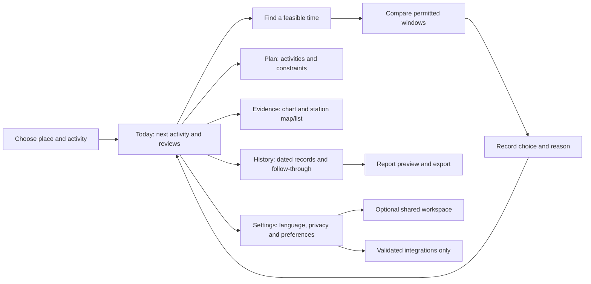

# Airday: frontend and user experience upgrade specification

Reviewed: **9 October 2026 (Asia/Kolkata)**. Companion to [FEATURE_RESEARCH.md](FEATURE_RESEARCH.md) and [FEATURE_IMPLEMENTATION_MAP.md](FEATURE_IMPLEMENTATION_MAP.md).

**Outcome:** 36 useful frontend/experience upgrades, each classified against the Airday source at review time, plus a proposed screen structure, component map and delivery order.

**Implementation update, 9 October 2026:** the first supported UX bundle is now integrated. It adds task views, shared context, guided quick setup, structured comparison/preview, station details, help and local privacy controls. See [FRONTEND_UX_IMPLEMENTATION.md](FRONTEND_UX_IMPLEMENTATION.md) for the current per-ID ledger, exact limits and outstanding browser review. The tables below preserve the research baseline; they are not a claim that all 36 recommendations are delivered.

## 1. What was actually reviewed

I revisited the four requested public websites with browser screenshots and their visible controls/content. I also opened Airveda's linked public map, selected a city marker, and switched Oizom's public module presentation from Overview to Reports. This verifies the public presentation and those interactions, not a vendor's authenticated application or its data accuracy.

| Reference                                                                                                    | Public material reviewed                                                                                                                                  | Evidence boundary                                                                                                                                |
| ------------------------------------------------------------------------------------------------------------ | --------------------------------------------------------------------------------------------------------------------------------------------------------- | ------------------------------------------------------------------------------------------------------------------------------------------------ |
| **AV** — [Airveda Smart City](https://www.airveda.com/smart-city-sector)                                     | Sector page, pictured web/mobile screens, linked [public map](https://www.airveda.com/aqi), colored station/city markers and selected-city detail content | Map interaction directly observed; pictured mobile screens are examples. No Airveda account/device setup attempted                               |
| **OZ** — [Oizom](https://oizom.com/) / [Envizom](https://oizom.com/envizom-air-quality-monitoring-software/) | Homepage/use-case cards, dashboard image, public module navigation, Overview/Reports selections and descriptions                                          | Public module selector operated; dashboard controls inside the hero image were not live controls. Customer workspace/report generation not tried |
| **AT** — [AirTrack](https://www.airawarelabs.com/airtrack)                                                   | Phone previews, date/hour/window presentation, getting-started section, pollutant explanations and published integration/FAQ descriptions                 | Mobile product patterns observed in previews/documentation. No app installation, account, background tracking or wearable connection tested      |
| **AM** — [Ambee Clean Routing](https://www.getambee.com/products/clean-routing)                              | Map-oriented hero, concise action hierarchy, feature cards, use-case content and published route-ranking description                                      | Product marketing page; no operational route planner was exposed or exercised here                                                               |

Airday was compared through its current React/CSS source and the two existing audit documents. Localhost browser automation was previously rejected by saved permissions; it was not retried or bypassed in this review. Therefore **missing/partial means source-supported**, and proposed spacing/mobile layouts require a future rendered usability pass. No tests, provider authentication or deployment were run for this research.

“Better” below means a promising improvement in clarity, effort or decision completion for Airday. It is a design judgment, not a measured usability advantage established by vendor claims. Our proposed controls, wording, layout and implementation are original adaptations.

## 2. The useful contribution from each product

### Airveda: help people understand the place

The public map makes geography visible, lets a person select a marker, and exposes city/pollutant context. Its sector page shows examples of mobile trends and public displays. The useful adaptation is a linked map/list/detail experience, not a requirement to lead every visit with a full-screen map. [Airveda map](https://www.airveda.com/aqi), [Smart City page](https://www.airveda.com/smart-city-sector)

**Take for Airday:** station locations and distance, selection-linked evidence details, explicit layer controls and a large-text public evidence view. Keep individual station provenance; city aggregation and AQI colors do not authorize us to synthesize an official Indian AQI.

### Oizom: organize information by the work someone is doing

Envizom's public module navigation separates monitoring, reports, alerts and other tasks. Its preview and descriptions expose chart/table and time-period choices. The Reports selection changes the relevant content without leaving that section. [Envizom](https://oizom.com/envizom-air-quality-monitoring-software/)

**Take for Airday:** clear task navigation, readable evidence modes, a review inbox, scoped site groups and a report workflow. Airday needs a compact set of destinations appropriate to its users rather than every industrial module shown there.

### AirTrack: make the activity the starting point

AirTrack's public phone preview places day selection and an hourly highlighted window together. Its getting-started section explains a short journey; other published content connects activities with personal recaps and explanations. [AirTrack](https://www.airawarelabs.com/airtrack)

**Take for Airday:** quick activity entry, a dated timeline, a clearly highlighted feasible time, plain-language help and user-reported progress. Preserve concentrations and model limits rather than adopting its proprietary score or native tracking promises.

### Ambee: explain the choice between alternatives

Ambee's page presents environmental routing as a practical choice, uses concise feature cards and places a clear next action beside the product explanation. Its published route concept ties environmental evidence to travel alternatives. [Clean Routing](https://www.getambee.com/products/clean-routing)

**Take for Airday:** bounded comparison cards and visible trade-offs. For the current project, compare permitted activity times with the existing model. Actual pollution-aware route ranking remains conditional on the data gates already documented.

## 3. Airday capabilities to preserve

These are present in source. They should not be listed as newly missing features:

| Existing capability                                                                                            | Source evidence                                                        | Improve through                                                                                             |
| -------------------------------------------------------------------------------------------------------------- | ---------------------------------------------------------------------- | ----------------------------------------------------------------------------------------------------------- |
| Confirmed place, Indian search, device location with permission/cancel/forget controls                         | `src/App.tsx`: location panel and `useDeviceLocation`                  | Compact placement, guided setup and favorites; do not add automatic continuous tracking                     |
| Today/tomorrow/date selection within the returned horizon                                                      | `src/App.tsx`: date controls                                           | Consistent context across screens; do not advertise a four-day horizon merely because a vendor preview does |
| Prominent plan-review heading and primary review/setup action                                                  | `src/App.tsx`: `decision-card`                                         | Correct unresolved/current-record counts and a concise next-activity card                                   |
| PM2.5/PM10 chart, selected hour, threshold/activity shading and hourly table                                   | `src/components/ForecastChart.tsx`                                     | Feasible/chosen-window preview, optional pollutant focus and period controls                                |
| Separate monitor name/value/time/distance/source and independent provider states                               | `src/App.tsx`: monitor/provider sections; `src/lib/evidence-status.ts` | Map/list/drawer, compact summary followed by detailed provenance                                            |
| Plan modal, recurrence, example/custom rule explanation, flexible-time constraints, alternatives and decisions | `PlanEditor.tsx`, `DecisionEditor.tsx`, planner and journal helpers    | Short initial flow, templates, comparison cards and explicit editor opening                                 |
| Local journal, reopening, follow-through, JSON export and historical disclosure                                | `src/App.tsx`, `src/lib/decision-state.ts`, `storage.ts`               | Searchable history, record-level actions and frozen printable/CSV report                                    |
| English/Hindi decision-summary text and `.txt` download                                                        | `src/components/DecisionSummary.tsx`                                   | Full flow localization and a clearer share/report preview                                                   |
| Optional role-based workspace and audit/approval code                                                          | `src/components/WorkspacePanel.tsx`, `api/workspaces.mjs`              | Per-record proposal/review UX; cloud behavior still needs verification                                      |
| Responsive grids, 44-pixel controls, focus/skip link and reduced-motion rules                                  | `src/App.css`, `src/index.css`                                         | Preserve these foundations while introducing navigation/drawers; rendered accessibility still unverified    |

The 20 earlier design remedies remain documented in [DESIGN_AUDIT.md](DESIGN_AUDIT.md). The later [WEBPAGE_AUDIT.md](WEBPAGE_AUDIT.md) tracks 35 findings; 1–6/18 are repaired, with other findings still outstanding. This review adds a product-experience layer and does not reset their status.

## 4. Complete upgrade catalog

**Status:** Missing = no equivalent current flow; Partial = a foundation exists but the specific experience is incomplete. **Priority:** Now = improve the core decision flow first; Next = extend a stable release; Gated = requires licensed data, cloud integration or hardware first; Polish = optional lower-priority preference.

References identify the inspiration described above. Concrete Airday behavior and acceptance criteria below are **our design recommendations**, not claims that those exact controls were exercised in vendor apps.

### A. Entry, navigation and setup

| ID       | Missing or incomplete experience    | Current Airday / inspiration                                                                                     | Proposed adoption and done condition                                                                                                                             | Priority / roadmap             |
| -------- | ----------------------------------- | ---------------------------------------------------------------------------------------------------------------- | ---------------------------------------------------------------------------------------------------------------------------------------------------------------- | ------------------------------ |
| **UX01** | Clear task navigation               | Missing: header has brand/context/My plan; activities, evidence and history share one long page. OZ/AT           | Add Today, Plan, Evidence, History and Settings; preserve state/date/location when navigating and support Back/deep links                                        | **Now** · W03; F02/F07         |
| **UX02** | A compact next-action home          | Partial: large review card exists; coverage and guidance sections still precede the working activity list. AT/AM | Lead with next activity + unresolved reviews + evidence mode + one action; counts reflect recorded/reopened/current evidence rather than forecast crossing alone | **Now** · F02/F16; audit 10/26 |
| **UX03** | One-off activity without full setup | Missing: recurring timetable setup is the principal path. AT/AM                                                  | “Find a time” accepts date, duration and allowed hours; selecting an option records the actual chosen window in the same journal                                 | **Now** · F01                  |
| **UX04** | Use-case templates                  | Missing: generic plan editor starts from school-like example activities. OZ/AT                                   | School day, walk/exercise, outdoor work and commute-time templates; show editable example activities and constraints before confirming                           | **Now** · F02/F17; audit 27    |
| **UX05** | Short guided onboarding             | Partial: place/plan confirmation exists; the complete editor is the first planning setup. AT                     | Three steps: confirm place → choose/add activity → review rule/constraints; show progress, Back and a visible example preview; optional settings appear later    | **Now** · W02/W03; audit 27    |
| **UX06** | Persistent place/date context       | Partial: location/date controls exist in separate sections; header lacks compact selected context. AV/AT         | Compact place selector and date control across working screens, with a preview label when unconfirmed; no jump to another city/date on navigation                | **Now** · W03/W06              |
| **UX07** | Favorite place switching            | Missing: one saved place. AV/AT-inspired adaptation                                                              | Up to five named favorites with source-coverage cues; a switch refreshes only that place and never carries another location's decision into it                   | **Next** · F04                 |
| **UX08** | Help attached to the task           | Partial: explanations/source links exist, but no structured help journey. AT/OZ                                  | Inline “Why review?”, “What is PM2.5?” and “Why no station?” disclosures plus searchable short help; preserve current source links                               | **Now** · F17; W03/W09         |

### B. Planning and comparison

| ID       | Missing or incomplete experience           | Current Airday / inspiration                                                                                                  | Proposed adoption and done condition                                                                                                                                           | Priority / roadmap             |
| -------- | ------------------------------------------ | ----------------------------------------------------------------------------------------------------------------------------- | ------------------------------------------------------------------------------------------------------------------------------------------------------------------------------ | ------------------------------ |
| **UX09** | Dated activity timeline                    | Partial: recurring activity cards and latest record blocks exist. AT                                                          | Chronological cards show original/chosen time, unresolved/reviewed/recheck state and follow-through; history is reachable from each card                                       | **Now** · F02; audit 10–12     |
| **UX10** | Side-by-side alternative choices           | Partial: alternatives are buttons with time/peak, lacking a structured comparison. AM/AT                                      | Show original and up to three feasible windows with duration, model peak, coverage and constraint trade-offs; complete comparable inputs required; no “safe” badge             | **Now** · F01/F02; audit 14/28 |
| **UX11** | Preview the chosen result                  | Partial: chart highlights an activity but does not provide a complete chosen-plan preview. AT                                 | Selecting an alternative updates a proposed-window band and original/chosen comparison before recording; cancel restores the prior view; no saved mutation during mere preview | **Now** · W02/W03; audit 28    |
| **UX12** | Scan a day's usable windows quickly        | Missing: only the full line chart/hour inspector. AT preview                                                                  | Add optional time strip linked to the feasible-window engine and constraints; use text/hatching for gaps and mark the selected duration; retain full chart/table               | **Next** · F01/F02             |
| **UX13** | Focus one pollutant without losing context | Partial: PM2.5/PM10 are always plotted together. AT/OZ                                                                        | Choose PM2.5, PM10 or both; keep the active planning pollutant/rule explicit; additional gas tabs appear only with validated data                                              | **Next** · F11; W04            |
| **UX14** | Explicit period controls                   | Missing: selected day chart only. OZ                                                                                          | 1/8/24-hour or dated period view with units/statistic/completeness; distinguish derived averages from observations; unsupported periods disabled with a reason                 | **Next** · F12/F07             |
| **UX15** | Short chart-to-action explanation          | Partial: numerical chart metadata and long review copy exist. AT/AM                                                           | Show one activity-specific sentence about the rule/available alternatives, with source/time and “How calculated”; no AI needed                                                 | **Now** · F17                  |
| **UX16** | Progressive activity editing               | Partial: one large plan dialog includes advanced fields. AT/OZ-inspired adaptation                                            | Start with name/date/time or duration; reveal recurrence/flexibility/exclusions/indoor option only when relevant; retain all validation and restore drafts on error            | **Now** · W03; audit 27        |
| **UX17** | Intentional action/edit interaction        | Partial: browsing the decision select can open a dialog; same-action/review needs careful handling. AM/AT-inspired adaptation | Select an option, then press a labeled Continue/Record action; re-review and reopen are explicit; keyboard browsing does not commit/open unexpectedly                          | **Now** · W03; audit 9/21–24   |

### C. Place and evidence exploration

| ID       | Missing or incomplete experience        | Current Airday / inspiration                                                                            | Proposed adoption and done condition                                                                                                                                       | Priority / roadmap           |
| -------- | --------------------------------------- | ------------------------------------------------------------------------------------------------------- | -------------------------------------------------------------------------------------------------------------------------------------------------------------------------- | ---------------------------- |
| **UX18** | Station map linked to a list            | Missing: monitor cards only. AV/OZ                                                                      | Map/List toggle, place and station markers, distance/time/source, accessible list, permissioned tile service; map outage leaves planning/list working                      | **Next** · F03               |
| **UX19** | Selected station detail drawer          | Partial: full metadata is repeated within monitor cards. AV                                             | Choose a point/list item → compact detail drawer with timestamp/age, pollutant/period/unit, quality, distance and source; preserve focus and Back/close behavior           | **Next** · F03/F16           |
| **UX20** | Explicit map layers and legends         | Missing: no map. AV                                                                                     | Separate station/fire/optional weather layers; display acquisition/valid time and legend; fire starts off to reduce clutter and never implies causality                    | **Next/Gated** · F03/F24/F23 |
| **UX21** | Consistent evidence-status presentation | Partial: badge, provider copy, policy/coverage panels exist; some raw statuses appear. AV/OZ            | Compact “what is available” strip with accessible icons/text, last attempt/success/reading time; expand details instead of repeating long paragraphs; never hide a failure | **Now** · F16; audit 7/30    |
| **UX22** | Weather next to the planned window      | Missing: air-only evidence. AV/OZ                                                                       | Small activity-scoped temperature/rain/wind panel with source/time; separate weather criteria and unavailable state; pollution decision works if weather fails             | **Next** · F23               |
| **UX23** | Historical evidence browser             | Missing: chart is forecast-day focused; backend archives do not provide a usable trend screen. AV/OZ/AT | Bounded retained-date filters, pollutant/source selection, visible gaps and separate model/observed series; no imaginary earlier history                                   | **Next** · F07               |
| **UX24** | Named site/group overview               | Missing: one-place working context; organization workflow exists separately. OZ                         | Group favorites/sites with evidence age and outstanding actions; local groups first, shared groups require membership; no inferred campus measurement                      | **Next/Gated** · F14/F15     |

### D. Review, history and sharing

| ID       | Missing or incomplete experience            | Current Airday / inspiration                                                                 | Proposed adoption and done condition                                                                                                                                              | Priority / roadmap                     |
| -------- | ------------------------------------------- | -------------------------------------------------------------------------------------------- | --------------------------------------------------------------------------------------------------------------------------------------------------------------------------------- | -------------------------------------- |
| **UX25** | Review inbox with useful reasons            | Missing: banners/notices exist, but no material-change alert inbox. OZ/AT                    | One item per activity/date/material transition; show threshold crossing, missing coverage or aged evidence and a direct review action; dismissal does not hide a later transition | **Now** · F05                          |
| **UX26** | Notification preferences and delivery state | Partial: workspace approval email preference exists; no general review/brief settings. OZ/AT | Explain in-app versus closed-tab email, consented plan sync, quiet hours/daily brief and unsubscribe; pending/accepted/delivered/unknown remain distinct                          | **Gated** · F06                        |
| **UX27** | Searchable decision history                 | Partial: latest local record, historical JSON disclosure and shared audit list. AT/OZ        | Filter by date/place/activity/state; open a readable frozen record, see original/chosen plan, record follow-through, reopen or submit that eligible record                        | **Now/Next** · F02/F15; audit 11/19–20 |
| **UX28** | Report chooser with preview                 | Partial: JSON journal export and plain-text summary download. OZ                             | Choose date/activity and CSV/print, preview sources/coverage/actions/private fields, then export frozen records; browser print-to-PDF first                                       | **Now** · F08; audit 13                |
| **UX29** | Honest recap and personal progress          | Missing: no daily/weekly outcome view. AT                                                    | Private reviewed/recheck/completed counts and reported outdoor minutes; distinguish planned/reported/model-estimated quantities; no proprietary health score                      | **Next** · F09/F20/F10                 |
| **UX30** | Feedback where a suggestion is shown        | Missing: no usefulness/practicality input. AT published feedback pattern                     | Useful/not useful + bounded practical reason, saved locally; cloud submission explicit; keep the existing decision reason as a separate field                                     | **Next** · F19                         |
| **UX31** | Large-text read-only display/share view     | Missing: current dashboard includes local/private working controls. AV/OZ                    | Sanitized public evidence display with source/age/QR link; no exact GPS/private plans/reasons; readable offline/unavailable state                                                 | **Next/Gated** · F13/F22               |

### E. Language, trust and optional personalization

| ID       | Missing or incomplete experience        | Current Airday / inspiration                                                                                                          | Proposed adoption and done condition                                                                                                                                          | Priority / roadmap                                                |
| -------- | --------------------------------------- | ------------------------------------------------------------------------------------------------------------------------------------- | ----------------------------------------------------------------------------------------------------------------------------------------------------------------------------- | ----------------------------------------------------------------- |
| **UX32** | Language across the working flow        | Partial: Hindi available only in summary text. OZ language entry point; adaptation for India                                          | Global English/हिन्दी preference for navigation/forms/errors/source states/reports; preserve user text/station names; validation remains equivalent                           | **Now** · W03/F17; audit 29                                       |
| **UX33** | One privacy/local-data settings journey | Partial: device-location disclosure/forget and export exist; complete import/recovery/delete flow absent. AT documented user controls | Show what stays local/cloud, consent and connected services; validated export/import/delete/recovery with preview; no silent data loss or blanket unverified compliance claim | **Now** · W01/W03; audit 31/35                                    |
| **UX34** | Supported integration setup screens     | Missing: indoor/wearable/provider extension setup is not a user flow. AT/OZ                                                           | Capability-aware catalog: supported vs unavailable, what is shared, connect/disconnect, last sync and observed device state; hide command actions until real gate passes      | **Gated** · F27–F29/F32; no new vendor OAuth flow until selected  |
| **UX35** | Optional dark appearance                | Missing: one light theme; AirTrack lists a dark option publicly. AT                                                                   | Respect system preference with an explicit override; validate chart/status/form contrast in both themes; no loss of state; ship after core usability                          | **Polish** · W03; adds no data capability                         |
| **UX36** | Earned trust and methodology surface    | Partial: source links/limits exist, but no concise consolidated “How this works” view. AV/OZ/AM proof presentation; AT science/help   | Show actual sources, resolution, timestamp meaning, rule calculation, real coverage and verified release status; add genuine pilot feedback only when obtained                | **Next** · F16/F17; no borrowed logos/certifications/testimonials |

UX35 and UX36 are small cross-cutting additions to the prior map, not claims of new backend features. Mobile bottom navigation, responsive drawers, chart insights and the first-use stepper are our adaptations of observed patterns; this review does not claim every vendor has those exact controls.

## 5. Proposed Airday experience

### First visit

1. Explain the outcome in one sentence: **“Find a workable time for outdoor activities using the air evidence available for your area.”**
2. Give two direct choices: **Use my location** and **Choose city/town**. Explain permission and retain manual search. Keep Delhi preview clearly labeled and optional.
3. Offer **Plan one activity** or **Use a template**. A school template is a shortcut, not a mandatory identity/account question.
4. Review the activity and user rule. Example values stay labeled until confirmed; do not default to a medically personalized or official threshold.
5. Show usable options, source age and coverage. Let the person choose/record, then show the chosen result and evidence.

### Returning visit

Restore the confirmed place/date/plan and show the next unresolved review. A recorded choice remains visible; changed evidence becomes a new review reason. If there is no useful forecast or recent monitor, say what is unavailable and what can still be done. Do not repeat initial setup or require sign-in for local planning.

### Screen structure

### Desktop layout

- Header: Airday, selected place, active date, language and accessible primary navigation. Keep account/workspace actions optional.
- Main area: next-review summary, quick-time finder and chronological activity cards.
- Secondary area: compact evidence availability and forecast preview with a route to full evidence details. On a small laptop this can stack; do not compress it into an unreadable multi-widget wall.
- Evidence screen: chart/interval tools, map/list and selected-station details. A selected activity can overlay its proposed/chosen time with explicit labels.
- History screen: dated records and follow-through first; export preview accessible from the chosen record/range.

### Phone layout

- Compact place/date context at the top. Four task destinations can sit in bottom navigation: Today, Plan, Evidence and History; Settings remains a labeled header/menu entry.
- First working card is the next activity/review or the one-off finder. Avoid a large decorative hero before the action.
- Compare choices as vertically stacked cards. Open evidence/record details in a labeled drawer or dialog with a close control, focus management and preserved draft.
- Allow vertical scrolling without trapping the user in a chart/map gesture. Keep list/table alternatives and all 44-pixel/focus/skip-link foundations.
- Bottom navigation must not cover content, the keyboard, a modal footer or a device safe area. These are design targets, not rendered results verified in this review.

### Behavior contract for an activity card

Show **name, date, original/chosen time, current review state, model statistic/unit, coverage/source time, recorded action and one primary next action**. Detailed provenance/history opens on demand. The primary action changes with state:

| State                       | Main action                                 | Secondary information                                     |
| --------------------------- | ------------------------------------------- | --------------------------------------------------------- |
| Example/unconfirmed setup   | Confirm activity / set up                   | Clearly labeled sample/example values                     |
| Awaiting evidence           | View source status / retry when appropriate | Distinguish queue pending from no data/failure            |
| Needs first review          | Compare options                             | User rule, feasible constraints and evidence limitations  |
| Recorded and current        | View recorded choice                        | Frozen evidence, original/chosen times and follow-through |
| Evidence materially changed | Review again                                | Exactly what changed; retain the earlier record           |
| Reopened                    | Record a decision                           | Previous action remains historical                        |
| Activity passed             | Record follow-through / view history        | Do not suggest rescheduling into the past                 |

## 6. Visual system and interaction details

Airday already has a forest-green/light visual identity and reusable card/button styles. Preserve those foundations and make the hierarchy more consistent. These are Airday design decisions, not extracted vendor color values.

| Element          | Proposed rule                                                                                                                                                                     |
| ---------------- | --------------------------------------------------------------------------------------------------------------------------------------------------------------------------------- |
| Color            | Green for brand/action, blue for model context, amber for review/degradation, distinct error tone for failure. Color always accompanies text/icon; no green “safe air” signal     |
| Type             | One display/body family pair or system fonts; local/self-hosted loading when licensed. Short headings, readable labels and tabular numbers for values/times; support Devanagari   |
| Spacing          | Consistent 4/8/12/16/24/32 spacing tokens; group context with its action. Dense metadata moves into details, not tiny text                                                        |
| Numbers          | Show unit, pollutant and period beside the value. Keep model peak, observed concentration, source timestamps and derived averages visually distinguishable                        |
| Cards            | A consistent hierarchy: context → result/state → next action → optional detail. Use activity/clock/location icons to support labels, never replace them                           |
| Charts           | Plain labels, restrained grid lines, explicit gaps, visible isolated points, selected/chosen-window overlays, accessible table and keyboard hour controls                         |
| Comparison       | Same statistic/duration/date/source basis; selected card is visibly proposed until recorded. Duration and feasibility stay beside any modeled reduction                           |
| Status           | Compact summary plus “Details”; display data age and last attempt separately. Never bury a missing-data qualifier behind an optional tooltip                                      |
| Motion           | Brief selection/feedback transitions; respect reduced motion. No auto-rotating critical message, decorative typing headline or essential auto-advancing carousel                  |
| Loading/recovery | Stable-sized loading placeholder with text; explicit timeout/no data/retry; a failed refresh retains dated evidence and a clear failure message                                   |
| Save/undo        | Visible “saved in this browser,” “session only,” “submitted” or “saved; refresh failed”; deliberate focus restoration for dismiss/Undo; no action committed by exploring a select |
| Sharing          | Preview the dated frozen record and included private fields before export/copy/print; public links only use the sanitized public projection                                       |

## 7. Patterns we should decline

Some public presentation choices do not serve Airday's working dashboard:

- Large marketing photos, sales enquiry forms, pricing tables and client-logo walls at the start of the planning flow. If a separate landing page is added, keep a direct route into the planner.
- Oizom's typing headline or floating help bubble covering content; choose a stable title and a deliberately opened help panel.
- Airveda's dense mixture of air and fire markers as the default. Offer layers and clustering with a list; fire detection is context, not attribution of a local PM reading.
- AirTrack's native 24/7 tracking and proprietary exposure score. A browser-local activity planner does not provide those capabilities merely by using similar-looking screens.
- Ambee's safest/healthiest route wording, pollen screens or fine-grid map appearance without verified Indian coverage and suitable resolution.
- Mandatory sign-in/integration on first use. Guest local planning already offers a useful lower-effort experience.
- Colour-only categories, health improvement promises, fake testimonials/certifications, “live” badges for stale evidence or sample values presented as observations.
- Drag-only/auto-advancing carousels for essential choices; use visible comparison cards with keyboard controls.

## 8. Frontend component and roadmap map

Proposed paths are new work, not current files. Keep the existing planner, evidence helpers, journal and request guards authoritative.

| Package                                | Components/controllers to add or extend                                                                      | UX IDs         | Data / release dependency                                                                   |
| -------------------------------------- | ------------------------------------------------------------------------------------------------------------ | -------------- | ------------------------------------------------------------------------------------------- |
| Navigation/context                     | `AppNavigation`, `ContextBar`, `useViewState`; extend `App.tsx`                                              | 01/02/06       | Current place/date state; Back/deep-link and unsaved-draft handling                         |
| Setup and quick activity               | `SetupStepper`, `ActivityTemplates`, `QuickTimeFinder`; refine `PlanEditor`                                  | 03/04/05/16    | W02 shared constraints/assessment; example/confirmed distinction                            |
| Timeline/decisions                     | `ActivityTimeline`, `ActivityCard`, `WindowComparison`, `ChosenWindowPreview`; refine `DecisionEditor`       | 09/10/11/17    | W01/W02 scoped immutable records; audit action-loop fixes                                   |
| Chart/evidence                         | Extend `ForecastChart`; `WindowStrip`, `EvidenceStatus`, `StationMap`, `StationList`, `StationDrawer`        | 12–15/18–23    | F03 map license; F07 history; F11/F12/F23/F24 valid series/contracts                        |
| Review/history/report                  | `ReviewInbox`, `DecisionHistory`, `ReportPreview`, `RecapView`, `SuggestionFeedback`                         | 25/27–30       | F05/F08/F09/F19/F20; frozen data, correct counts and private-field preview                  |
| Settings/localization/help             | `SettingsPanel`, `LanguageControl`, `LocalDataControls`, `HelpPanel`, `MethodologyView`; locale dictionaries | 08/32/33/35/36 | W01 recovery/concurrency, W03 accessibility/localization; theme polish later                |
| Conditional shared/public/integrations | Refine `WorkspacePanel`; `GroupView`, `NotificationSettings`, `PublicDisplay`, `IntegrationSetup`            | 24/26/31/34    | Actual membership/email, source redistribution rights, verified supported hardware/platform |

Navigation is a view/controller concern; the current monolithic `App.tsx` should be split incrementally. A redesign must not clone competing assessment logic into cards, charts, alerts and summaries. One activity view model drives them all, as specified in W02 of the implementation map.

### Build order

1. **Core hierarchy and correctness:** UX01/02/06/09/17/21, including the existing audit items affecting counts, choices and status wording.
2. **Short planning journey:** UX03/04/05/08/10/11/15/16, using the same decision journal and constraints.
3. **Complete the action:** UX25/27/28/32/33, with dated history, report preview and equivalent Hindi flow.
4. **Explore evidence:** UX07/12–14/18–20/22–24 after source/map/history gates pass.
5. **Longer-term use:** UX29/30/36; UX35 after contrast/usability work. Gated UX26/31/34 release only when their cloud/data/hardware behavior is proven.

For two days, keep the working F02/F01 loop and deployment first. This list is the complete frontend backlog, not a requirement to squeeze 36 improvements into that window.

## 9. Definition of a successful frontend upgrade

These are proposed acceptance checks, not tests performed in this research:

- A first-time user finds a useful next action without interpreting a generic AQI score or completing a large recurring plan first.
- The same place/date/activity/result is shown across headline, timeline, chart, editor, alert, history and report; alternative preview does not silently save a decision.
- Recorded/reopened/superseded/recheck states are understandable, and provider failure does not hide an old reading's age.
- A person can complete the flow with keyboard and screen reader, at phone widths and high zoom, in English/Hindi; map/chart alternatives are usable and focus is preserved.
- Location denial, no station, incomplete forecast, unavailable tiles, failed save, cloud refresh failure and offline operation each have an understandable path forward.
- Shared/public/private views expose only their intended records; local-data changes, import/recovery and concurrent tabs preserve integrity.
- A three-minute video can show the real task, a working chosen response, retained evidence and genuine AWS deployment without navigating a wall of unfinished features.

When implementation begins, retain the current integrity regressions and add the specific checks authorized for each change. Update release/audit status from actual code and integration evidence; a polished appearance alone does not establish accuracy, accessibility conformance or enterprise reliability.

## 10. Recommendation

Adopt **AirTrack's activity focus**, **Airveda's place exploration**, **Oizom's task organization**, and **Ambee's understandable alternatives**, using Airday's own evidence and limitations. The frontend should make this loop obvious:

**My place → my activity → available evidence → feasible choices → recorded decision → review when something changes.**

The complete feature architecture remains in [FEATURE_IMPLEMENTATION_MAP.md](FEATURE_IMPLEMENTATION_MAP.md); this document is its frontend/experience specification. Application behavior is unchanged by these documentation updates.
