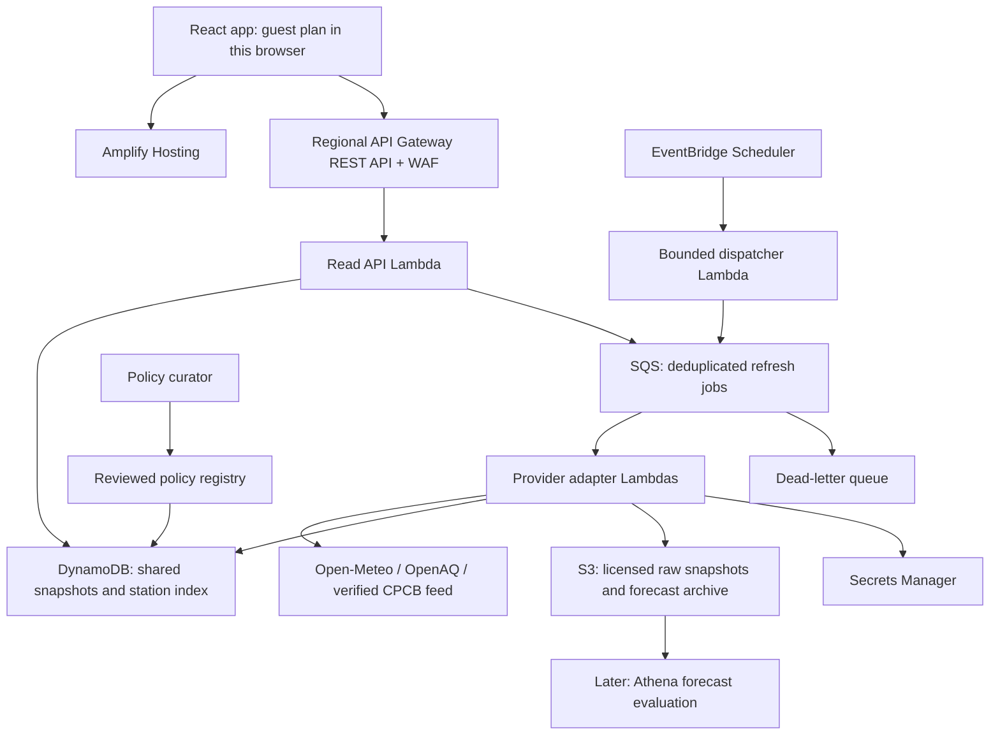

# Airday: verified solutions and implementation plan

Research date: **8 October 2026 (IST)**. This document preserves the researched plan and its external release gates. The software architecture and operational tooling have since been implemented; see [ARCHITECTURE.md](ARCHITECTURE.md) and [RELEASE_STATUS.md](RELEASE_STATUS.md) for current evidence. AWS deployment, authenticated station coverage and real-world pilot validation remain open.

For the subsequent Airveda/Oizom/AirTrack/Ambee-inspired additions, see [FEATURE_IMPLEMENTATION_MAP.md](FEATURE_IMPLEMENTATION_MAP.md). It maps all 32 proposed features onto this foundation, with a two-day core scope, phased engineering packages and explicit provider/device release gates. Those additions are planned, not marked implemented here.

## 1. Product outcome and scope

Help a person responsible for an outdoor activity choose a workable response, record it, and understand the evidence and its limitations. Schools are the initial pilot and demo story; the same activity model supports families, outdoor workers, and community groups across India.

Keep the existing guest experience and browser-local plan for the first release. Add shared accounts and staff approval only when institutional pilots need them. Indian city search and regional forecasts can support broad access; station coverage is described for each lookup rather than guaranteed nationwide.

Success means an actual decision changed and was followed through. Track activities reviewed, outdoor minutes rescheduled, chosen alternatives, and user-reported follow-through. These are operational outcomes, not proof of reduced inhaled dose, fewer illnesses, or cleaner city air. Establishing those effects requires separate measurement and research.

## 2. What research verified, and what remains unverified

| Source or claim                                  | Verified evidence                                                                                                                                                                                                                                                                                                                                                                                                                                                                                                                                                 | Remaining check                                                                                                                                                                                                                           |
| ------------------------------------------------ | ----------------------------------------------------------------------------------------------------------------------------------------------------------------------------------------------------------------------------------------------------------------------------------------------------------------------------------------------------------------------------------------------------------------------------------------------------------------------------------------------------------------------------------------------------------------- | ----------------------------------------------------------------------------------------------------------------------------------------------------------------------------------------------------------------------------------------- |
| Open-Meteo / CAMS Global                         | Official documentation identifies a roughly 45 km grid, 3-hour source steps, updates every 12 hours, and PM concentrations. Returned coordinates identify the selected model grid cell. [Documentation](https://open-meteo.com/en/docs/air-quality-api).                                                                                                                                                                                                                                                                                                          | Actual forecast accuracy by Indian city, lead time, season, and high-pollution event.                                                                                                                                                     |
| OpenAQ v3                                        | Locations, sensors, latest values, measurement history, hourly averages, coverage metadata, and flags endpoints are documented. [Locations](https://docs.openaq.org/resources/locations), [measurement history](https://docs.openaq.org/resources/measurements), [flags](https://docs.openaq.org/api/operations/location_flags_get_v3_locations__locations_id__flags_get).                                                                                                                                                                                        | Which Indian stations return current, usable observations with our account key; availability of metadata/flags on those stations.                                                                                                         |
| OpenAQ latest polling                            | Documentation explicitly warns that late-arriving measurements may be missed by polling latest alone. [Latest documentation](https://docs.openaq.org/resources/latest).                                                                                                                                                                                                                                                                                                                                                                                           | Source-specific reporting delays and the necessary history reconciliation period.                                                                                                                                                         |
| CPCB National AQI                                | CPCB describes pollutant sub-indices, the worst-sub-index rule, averaging periods, and data completeness requirements. [Methodology report](https://airquality.cpcb.gov.in/ccr_docs/FINAL-REPORT_AQI_.pdf).                                                                                                                                                                                                                                                                                                                                                       | A supported, machine-readable official AQI integration, if requested later.                                                                                                                                                               |
| CPCB data.gov.in adapter                         | Repository uses resource `3b01bcb8-0b14-4abf-b6f2-c1bfd384ba69`. It currently assumes `pollutant_avg` is PM concentration and hardcodes µg/m³.                                                                                                                                                                                                                                                                                                                                                                                                                    | The government resource page could not be fetched during this research. Units, statistic/window, `last_update` semantics, pagination, rate limits, and live station coverage require official metadata and a real authenticated response. |
| CAQM / education directions                      | An official PIB release documents the GRAP revision of 21 November 2025. CAQM's indexed homepage lists Advisory 18, dated 10 September 2026, about rescheduling November–December physical sports competitions. A Delhi education circular illustrates a separate school implementation/revocation step. [PIB revision](https://www.pib.gov.in/PressReleaseIframePage.aspx?PRID=2192852), [CAQM index](https://caqm.nic.in/), [Delhi circular](https://edudel.nic.in/upload/upload_2025_26/Schoolbranch_RegardingRevocationofGRAPIIIMeasures_dt_22012026_62.pdf). | Full text, applicable jurisdiction/activity, effective period, later amendments, and today's operative orders. The September advisory PDF was not retrieved; its exact action is not ready to encode.                                     |
| The previously pasted CPCB monitoring-report PDF | The supplied PDF link could not be retrieved.                                                                                                                                                                                                                                                                                                                                                                                                                                                                                                                     | Obtain the report before relying on its specific contents.                                                                                                                                                                                |

## 3. Best practical solution for each real-world issue

These are engineering recommendations for our constraints. Evidence supports the approach; it does not establish that one implementation is universally best.

### A. Planning around outdoor exposure

**Solution: a constrained activity planner.** For each activity capture duration, allowed times, days, intensity, and usable alternatives. Identify the forecast crossing within its existing window, then compare complete alternative windows of the same duration inside the user's allowed times. Rank by the same pollutant statistic, display the values and the improvement predicted by the model, and let the responsible person choose. If values or feasible alternatives are missing, say so.

For schools, include assembly/PE/recess and the availability of indoor space. Require the user to confirm that an indoor alternative is suitable; outdoor data cannot establish its indoor air quality. Never imply that a lower model value establishes safety or that moving indoors always reduces exposure.

WHO supports considering the timing and location of activity, while noting limitations in evidence for susceptible groups and differing settings. This supports offering reviewed options rather than a universal cancellation rule. [WHO personal interventions and risk communication](https://www.who.int/news-room/questions-and-answers/item/air-pollution-personal-interventions-and-risk-communication).

**Acceptance:** valid alternatives respect duration and timetable constraints; incomplete windows are excluded from rankings; the user can record a choice and explanation for a date.

### B. Regional forecast versus measurement at a school

**Solution: preserve model provenance and evaluate it prospectively.** Store the returned grid centre, valid times, retrieval time, model name, and model issue time only if actually supplied. Archive every forecast snapshot as it was available then. Compare those archived predictions with compatible observed periods at stations by city and forecast lead time. Historical reconstructed data must not be described as the forecast users originally saw.

Evaluate mean absolute error, signed bias, large-event errors, and missed crossings of the user's planning rule. Report sample counts and missingness. Use time-based holdouts and station holdouts; do not tune and evaluate on the same event. A station comparison establishes station-level performance, not conditions at every school. Start with the raw model; promote a correction only when held-out results improve without worsening important event misses.

A truly local observation requires an appropriately located instrument, maintained and evaluated against reference measurements. Treat campus sensors as a later measured pilot with installation, collocation, maintenance, and indoor/outdoor labelling. [EPA collocation guide](https://www.epa.gov/air-sensor-toolbox/air-sensor-collocation-instruction-guide).

**Acceptance:** every forecast has provenance; corrections are versioned and reversible; the app makes no unvalidated building-level precision claim.

### C. Distant, stale, or unavailable monitors

**Solution: select by usability and disclose representativeness.** Maintain a station/sensor registry, then apply a documented selection order: verified pollutant and unit, interpretable measurement period, valid time/coordinates, appropriate stationary instrument/site type where known, freshness, then distance. Show the closest valid station and nearby alternatives with an explanation. Distance alone cannot establish representativeness.

Use latest for quick display and reconcile history using paginated measurements/hourly endpoints with an overlapping lookback. Keep provider quality flags where present. Missing flags mean unknown quality, not a passed check. Late/corrected records are upserted with revision history. Missing monitor data leaves the regional forecast usable with a visible coverage gap.

OpenAQ's point/radius search permits at most 25 km; a future wider search must use documented bounding-box/country queries or our own licensed registry. [OpenAQ geospatial queries](https://docs.openaq.org/using-the-api/geospatial), [documented location flags endpoint](https://docs.openaq.org/api/operations/location_flags_get_v3_locations__locations_id__flags_get).

**Acceptance:** the selection reason, station identity, age, distance, measurement period, and source are inspectable; old or unverified data never receives a current-observation label.

### D. Providers disagree

**Solution: compare only compatible evidence and track shared origin.** Map provider station/sensor identifiers to a reviewed canonical identity. Retain uncertain matches as uncertain. Record owner, instrument, upstream network, pollutant, unit, statistic, and measurement period.

Two values become eligible for numerical comparison only when station identity, pollutant, units, and periods are compatible. A same-station match plus different processing remains a qualified comparison. Different sites or unknown periods remain separate context. The existing 2 km / one-hour heuristic is only a proximity description; it cannot validate accuracy or independence.

Keep both original values. Flag differences with a transparent reason and a product-configured tolerance; do not label either provider wrong without supporting evidence. Two APIs distributing the same measurement count as one observation origin. Licenses and attribution must follow the underlying source. [OpenAQ terms and upstream attribution](https://docs.openaq.org/about/terms).

**Acceptance:** duplicate-origin feeds never inflate a confidence score; mismatched units/windows cannot be averaged; a comparison explains why it is or is not eligible.

### E. PM concentrations versus official AQI and orders

**Solution: separate planning rules, published AQI, and official directions.** Keep the current PM-based planning rule. An hourly model value has a different meaning from an AQI built from required observation averages and sub-indices. The app should display official AQI only through a verified published source with its geography and timestamp, if that integration is added. Do not relabel our calculations as official.

Maintain a small reviewed policy registry for Delhi NCR first: issuing authority, document URL/hash, jurisdiction, applicable institutions/activities, effective dates, invocation/revocation records, reviewer, and last verification. A GRAP schedule is not evidence that a stage is currently invoked. A forecast threshold cannot automatically activate a school order. Other states require their own authorities and policies.

Document discovery may notify a curator of changes. Publication into executable rules requires review of the actual document. If policy freshness or applicability is unknown, show a direct source link and an explicit verification-needed state. Keep personal planning comparisons available, without implying they authorize activities covered by an order.

CPCB's method uses 24-hour averages for particulate matter and several gases, and 8-hour averages for CO/O3. [CPCB National AQI explanation](https://cpcb.nic.in/displaypdf.php?id=bmF0aW9uYWwtYWlyLXF1YWxpdHktaW5kZXgvQWJvdXRfQVFJLnBkZg%3D%3D).

**Acceptance:** tests distinguish concentrations, AQI, a published schedule, an invoked order, a revoked order, and unknown policy status. No policy is inferred from our model alone.

### F. An action process beyond a chart

**Solution: complete a review → decision → follow-through loop.** Store activity, date, reason, selected action, evidence snapshot, plan/rule version, and decision time. Permit rescheduling, shortening, keeping an activity with a recorded reason, using a suitable indoor option, or cancelling when the responsible person chooses. Add a user-entered check time and named responsibility in the pilot.

For institutional sharing later, add authenticated reviewer/approver roles and an append-only decision history. Notifications require opt-in recipients and an approved action, have deduplication and delivery status, and include the source time. A material data or policy change reopens review. Do not silently overwrite a staff decision. English/Hindi templates can be deterministic; generated text is optional after this loop works.

**Acceptance:** an action is recorded against the evidence that produced it, users can distinguish a suggestion from an approved decision, and a failed notification is visible.

### G. Uneven India-wide coverage

**Solution: a coverage registry that makes the gaps visible.** Publish forecast support, returned station count, nearest usable distance, reporting delay, pollutant availability, and last catalog refresh for each supported area. Count distinct station origins rather than API rows. Offer these states: regional forecast plus current observation; regional forecast with old/unverified observation; forecast only; observations only when the forecast fails; no usable air data.

Build the registry from approved metadata feeds, with pagination and a refresh timestamp. Coordinate users should query the spatial registry directly rather than depend on a city name matching a provider's spelling. Labels such as covered describe the available evidence; they do not certify local representativeness.

Pilot Delhi NCR, then check selected metros and smaller towns before publishing a coverage claim. Filling an actual measurement gap requires a suitable monitored/sensor deployment or another validated source; another API key alone cannot fill it.

**Acceptance:** every lookup explains available and missing evidence, including device-location lookups; unavailable data is never replaced with an unlabeled sample.

## 4. Shared data contract and deterministic decision logic

Use the same versioned types and pure decision functions locally and in AWS. Proposed record groups:

| Record            | Required provenance and state                                                                                                                                                                                                    |
| ----------------- | -------------------------------------------------------------------------------------------------------------------------------------------------------------------------------------------------------------------------------- |
| Observation       | Provider and upstream source; station/sensor/canonical identity; pollutant; value; verified unit; statistic; period start/end or explicit unknown; source time; retrieved time; coordinates/site type; flags; license; revision. |
| Forecast snapshot | Provider/model; requested area and returned grid centre; valid times; values/units; retrieved time; issue time or null; response hash; coverage; schema version.                                                                 |
| Policy            | Authority/document/hash; geography; activity/institution scope; effective dates; amendment/revocation links; reviewer; verification time and status.                                                                             |
| Decision          | Local plan or later tenant ID; activity/date; plan/rule version; evidence IDs; proposed and chosen action; reason; timestamps; actor/approval status where authentication exists.                                                |

Validate at ingestion and the API boundary. Reject malformed values, invalid coordinates and incompatible units from comparisons. Preserve valid zero values. Flag unusual jumps for review; do not automatically erase a genuine high-pollution peak. Unknown metadata stays unknown. Preserve raw provider responses where licensing permits.

Keep three independent dimensions in the UI: **planning result**, **data completeness/freshness**, and **official-guidance status**. Thus an available high value and an incomplete window can both be visible. Below-rule values never become a safe badge. A failed forecast must not hide otherwise usable observations.

Freshness rules are disclosed product settings. Begin with 15-minute monitor polling for the active pilot stations and a three-hour observation-age warning, then adjust by documented reporting cadence. Fetch active forecast cells hourly; warn when retrieval misses the expected schedule (initially two hours), separately from the model's update cycle. Retrieval time is not model issue time. The existing 15-minute forecast retrieval warning must be revised when moving to hourly ingestion.

## 5. AWS architecture

Use `ap-south-1` for the application backend. Preserve the React/TypeScript UI and AWS SAM infrastructure definitions.

Responsibilities:

- **Amplify:** HTTPS static app; security headers; no provider secrets. Keep the existing deployment workflow where practical.
- **API Gateway REST + regional WAF:** replace the direct public Function URL for the public pilot. Bound parameters, request sizes, and request rates; disable the old unauthenticated entry point so it cannot bypass controls. AWS documents direct WAF association for REST API stages. [AWS WAF integration](https://docs.aws.amazon.com/apigateway/latest/developerguide/apigateway-control-access-aws-waf.html).
- **Read Lambda:** serve shared cached evidence promptly. An absent/stale cache returns an honest state and queues a bounded refresh; it never triggers unrestricted upstream fan-out per user.
- **DynamoDB:** small registry/latest records, conditional refresh leases and deduplication, provider quota counters, and cache expiry. Index station spatial tiles/geohashes and query adjacent cells before distance filtering. Store times separately from deletion TTL; expired items may remain pending deletion. [DynamoDB TTL behavior](https://docs.aws.amazon.com/amazondynamodb/latest/developerguide/ttl-expired-items.html).
- **SQS + adapter Lambdas:** bounded concurrency, deadlines, exponential backoff with jitter, Retry-After handling, idempotent writes, provider-specific circuit breakers, and a dead-letter queue. Refresh failure preserves the last valid snapshot and its original times.
- **EventBridge Scheduler:** refresh only active demand areas/stations and reconcile their history. Expire demand so unused locations do not produce endless polling.
- **S3:** private encrypted archives with lifecycle retention; separate public evidence from any future personal/tenant records. Store no exact device location in provider archives. Raw responses are kept only where terms allow.
- **Secrets Manager:** least-privilege adapter access; secret redaction in logs; rotation procedure with cached reads. No keys in the frontend or repository.
- **CloudWatch and Budgets:** error/429 alarms, ingestion delays, queue age, old-data rates, cache hit rate, and cost notifications. Retain compact redacted logs.
- **Later Cognito + tenant data:** required before shared organization plans and staff roles. API derives tenant identity from authenticated claims and enforces it on every read/write; a browser-supplied tenant ID is not authorization. Keep the guest flow available.

Local equivalents: existing Node API, shared TypeScript domain library, SQLite/file-backed cache and fixture archives, and AWS SAM CLI for infrastructure development. Local substitutes need to exercise the same data contracts and failure states. Introduce queues/cache interfaces before changing production adapters.

## 6. Quotas, cost, and scaling

OpenAQ documents **60 requests/minute and 2,000/hour** for a free key. Open-Meteo's non-commercial tier documents **600/minute, 5,000/hour, 10,000/day and 300,000/month**, and no uptime guarantee. A commercial rollout needs the appropriate service plan or a compliant self-hosted setup; its data license and hosted-service access terms are separate. CPCB/data.gov.in limits remain unverified. [OpenAQ limits](https://docs.openaq.org/using-the-api/rate-limits), [Open-Meteo pricing and terms of access](https://open-meteo.com/en/pricing).

Initial capacity assumptions: **20 active stations, 20 active forecast cells, 100,000 read API requests/month, at most 5 GB hosting transfer, short logs and modest archives**. This is a bounded pilot, not a promise of unrestricted national concurrency.

- Twenty stations polled every 15 minutes use roughly 80 latest calls/hour, before metadata, pagination, flags and reconciliation. Reserve headroom and obey returned quota headers.
- Twenty forecast cells fetched hourly use roughly 480 calls/day. Use the model's returned grid identity to deduplicate; arbitrary coordinate rounding does not reliably identify its cell.
- A thousand stations polled individually every 15 minutes would need 4,000 latest requests/hour and exceed OpenAQ's free hourly allowance. Wider coverage requires slower polling, approved bulk ingestion, or a higher quota arrangement.
- Start internal limits below provider limits, account for all adapter routes and retries, and share counters across workers. Do not rotate multiple keys to evade quotas.

**Planning envelope: about $15–$35 for a low-traffic month**, leaving most of the $100 credits for later iteration. This estimate assumes no paid provider subscription, domain purchase, SMS, VPC/NAT gateway, always-running servers, or paid cloud build workload. Credits and taxes are account-dependent.

| Cost group                                  | Pilot planning allowance/month |
| ------------------------------------------- | ------------------------------ |
| Hosting and read API                        | $1–$5                          |
| Lambda, DynamoDB, SQS, Scheduler, S3        | $2–$8                          |
| One basic regional WAF ACL with a few rules | $8–$10                         |
| Secrets and compact CloudWatch logs         | $1–$4                          |
| Contingency                                 | Up to roughly $8               |

These are workload allowances, not a pricing-calculator quote or a spending cap. AWS's API Gateway example for Mumbai lists $3.50 per million REST calls; 100,000 calls is about $0.35 before transfer. Basic WAF charges include $5/ACL/month, $1/rule/month and request charges; two Secrets Manager secrets are approximately $0.80/month before access charges. Recalculate before provisioning. [API Gateway pricing](https://aws.amazon.com/api-gateway/pricing/), [WAF pricing](https://aws.amazon.com/waf/pricing/), [Secrets Manager pricing](https://aws.amazon.com/secrets-manager/pricing/), [Amplify pricing](https://aws.amazon.com/amplify/pricing/).

Set budget notifications at $20, $50 and $75; cap refresh demand and worker concurrency; provide a switch that disables ingestion and expensive routes while keeping the static site and last available evidence visible. Budgets and API throttles do not guarantee a hard spending ceiling. [AWS throttling guidance](https://docs.aws.amazon.com/apigateway/latest/developerguide/http-api-throttling.html).

Scale users through shared reads/cache, then scale ingestion according to licensed source quotas. Upgrade storage/indexing only after measured query load requires it. Any promised availability level requires operational ownership, measured uptime, restore drills, and provider arrangements that support it.

## 7. Implementation order and release gates

| Stage                                                                            | Work                                                                                                                                                                                                                                 | Gate before moving on                                                                                                                                                                                               |
| -------------------------------------------------------------------------------- | ------------------------------------------------------------------------------------------------------------------------------------------------------------------------------------------------------------------------------------ | ------------------------------------------------------------------------------------------------------------------------------------------------------------------------------------------------------------------- |
| P0: data truth, first work session                                               | Extract provider adapters; add provenance/unit/window validation; fix CPCB assumptions; allow observation-only responses; preserve original timestamps; add response contracts and honest source states.                             | At least one authenticated observation response is verified for the demo location. Ambiguous CPCB data is visibly unavailable for concentration comparison until verified. No guessed units or sample substitution. |
| P1: bounded AWS pilot, next 1–2 build days if credentials and metadata are ready | Shared cache, refresh leases, bounded ingestion/history jobs, Secrets Manager, REST API/WAF, redacted logs, cost controls, SAM deployment and smoke verification.                                                                    | Public HTTPS URL works; burst visits reuse cached evidence; a provider outage and 429 produce explicit states; secrets remain server-side; rollback is available.                                                   |
| P2: complete the action loop, following several build days                       | Constrained same-duration alternatives, evidence-linked decisions, useful indoor alternatives, export/shareable user-approved summary, Hindi/English templates, and coverage states. Review applicable Delhi NCR documents manually. | A school or other user can review, choose, recover an edit, and follow through. Unknown policy status and limited coverage are visible.                                                                             |
| P3: evidence and pilot learning, following 2–4 weeks                             | Archive forecasts prospectively; reconcile histories; measure model error; interview 3–5 prospective users across school/family/work contexts; pilot a small set of locations.                                                       | Report actual counts, missingness, delays, decision follow-through, and held-out evaluation. Timing is a learning target, not proof of accuracy after a fixed number of weeks.                                      |
| P4: institutional and wider release                                              | Cognito/tenant isolation, approver roles, durable audit history, opt-in delivery, backup/restore drills, source contracts, higher quotas as needed. Evaluate local sensors as a separate maintained pilot.                           | Authorization and restore checks pass, operations ownership exists, and declared capacity/data coverage match measured behavior.                                                                                    |

For a two-day hackathon, prioritize P0 and a small deployable P1 slice plus the existing working planning loop. Queue ingestion, institutional sharing, and calibration should expand in that order as verified inputs and time permit. A weekend release can demonstrate the core outcome; robust nationwide institutional operation is a subsequent release with these gates.

## 8. Verification plan

No additional tests were run during this planning request. Existing UI repairs and their earlier test results do not verify these proposed backend changes.

Before implementing a public release, verify:

1. **Data contracts:** null/zero/negative values, units/statistics, source timestamps, clock skew, incompatible averages, invalid coordinates, missing metadata, pagination and response schema changes.
2. **Planning:** India midnight boundaries, partial-hour windows, missing values, same-duration alternatives, unavailable indoor space, changed activity/rule versions, and no safe/official-label substitution.
3. **Provider behavior:** unconfigured/expired keys, 429 with reset headers, timeouts, malformed responses, late history, corrected records, duplicated stations and common upstream origins.
4. **Reliability:** repeated/failed queue deliveries, deduplication leases, cache stampedes, expired-but-not-deleted TTL records, resumed pages, partial provider failure, and archive restoration.
5. **Security and privacy:** dependency/secret scanning, input bounds, XSS defenses, CSP and security headers, direct endpoint bypass, redacted logs, data deletion, and tenant isolation before shared accounts.
6. **Real usability:** phone widths, 200% zoom, keyboard and screen reader, location denial, long station names, storage failure, and low-bandwidth loading. Prior localhost browser automation was blocked by saved permissions; rendered checks remain necessary.
7. **Performance:** proposed pilot target of p95 cached API responses under 1 second at 10 reads/second, with no viewer-driven increase in upstream requests. Measure this in the deployed environment before claiming it.

## 9. Judge-facing proof

Keep the three-minute video focused on one real activity: choose location, inspect source dates/coverage, review its window, choose a practical change, demonstrate persistence, and show the AWS hosting/API/cache resources. Use real provider values even if the activity does not cross the rule. A seeded timetable or simulated failure is labelled as such; archived readings show their actual date. Explain environmental impact through the action taken, while showing where local measurements and coverage remain limited.

**Next release step:** configure the OpenAQ key and AWS CLI profile locally, verify one real observation's identity/unit/time/freshness, then deploy and exercise the implemented shared pipeline. The code does not remove the external validation gates in P0–P4.
