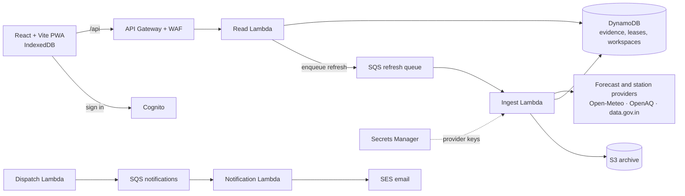

<h1 align="center">Airday</h1>

<p align="center">
  <b>India outdoor air planner.</b> Turns regional air-pollution evidence into a recorded, reviewable decision about outdoor activities.
</p>

<p align="center">
  
  
  
  
  
</p>

---

## Why

Schools, families, outdoor workers and community groups in India decide every day whether to hold an activity outside. Airday puts the evidence for that decision in one place, keeps **forecasts, station observations, personal rules and official guidance clearly separate**, and records what was decided and why, so the decision can be reviewed later. Schools are the first demo story.

## Features

**Planning**
- Search any Indian city or town, or use device location on request (no continuous tracking)
- Recurring activity editor with your own review threshold, flexibility constraints and an indoor option
- Same-duration, lower-forecast alternatives within the time range you allow
- Decisions are frozen together with the evidence shown when you made them; reminders when that evidence changes; follow-through tracking
- Quick-time finder, dated activity timeline, templates and a review inbox
- English and Hindi explanations and summaries

**Evidence**
- PM2.5 / PM10 forecast chart and exact hourly table with units, dates, grid description and attribution
- Nearby station observations with station, distance, owner, original timestamp, averaging period and quality status
- Optional station map, saved areas, retained history and trends, daily/weekly recaps, six pollutant views and period comparisons
- Explicit states for pending, forecast-only, observation-only, stale or missing data, unconfigured providers and paused ingestion. Fixture readings are never substituted for real data

**Teams (optional)**
- Cognito workspaces with role-based plan edits, proposals and approvals
- Atomic audit records, optimistic versioning and opt-in approval emails via SES

**Exports**
- CSV and print reports from frozen evidence, JSON export, validated backup import
- Offline reading in the production PWA; local planning data in IndexedDB with migrations and a session-only fallback

> Airday compares model values and observations. It does **not** certify that conditions are safe.

## Architecture



- **Reads never call air providers directly.** Requests within budget queue a refresh; workers fetch, archive and store evidence. A failed refresh keeps the earlier evidence and its original timestamps.
- **Bounded by design:** 20 active rounded areas and 20 OpenAQ stations by default (40 opt-in), hourly forecast refresh, 15-minute monitor refresh, shared quota caches, retries, cooldowns and dead-letter queues.
- **Keys stay server-side.** Provider keys live in `.env` locally and in Secrets Manager in AWS, never in `VITE_*` variables.

## Tech stack

| Layer | Tools |
|---|---|
| Frontend | React, TypeScript, Vite, GSAP, Leaflet, PWA build script |
| API | Node.js (ESM) handlers shared by the local server and Lambda |
| AWS | SAM, API Gateway, Lambda, DynamoDB, SQS, S3, Secrets Manager, Cognito, SES, WAF, CloudWatch, Amplify Hosting |
| Quality | `node --test`, oxlint, Prettier, security/config/infra check scripts, local benchmark |

## Getting started

Requires **Node 24** (or 22.18+) and **pnpm**.

```powershell
pnpm install
if (-not (Test-Path .env)) { Copy-Item .env.example .env }
pnpm dev
```

Open http://127.0.0.1:5174. Vite proxies `/api` to the local Node server on `127.0.0.1:3001`; both bind to loopback. Evidence is stored under the git-ignored `.airday-local/` folder. The first request may show **Retrieval queued**, and the UI checks again after five seconds.

City search and forecasts work without any key. For live station readings, add `OPENAQ_API_KEY` to `.env` and restart. `pnpm preflight` reports which keys are present without printing them.

### Configuration

| Variable | Purpose |
|---|---|
| `OPENAQ_API_KEY`, `DATAGOV_API_KEY` | Optional station observations |
| `OPEN_METEO_API_KEY` | Optional commercial forecast access |
| `FIRMS_MAP_KEY` | Optional fire data (disabled by default) |
| `ALERT_SIGNING_KEY` | Server-side signing key, at least 32 random characters |
| `AIRDAY_MAX_ACTIVE_STATIONS` | Station capacity (default 20, pilot may use 40) |
| `VITE_STATION_MAP_ENABLED` | Show or hide the OpenStreetMap station map |
| `VITE_API_BASE_URL` | API Gateway URL for Amplify builds |

See [`.env.example`](.env.example) for the full list, including feature flags that start disabled.

## Checks

```powershell
pnpm test              # offline suite with labelled synthetic fixtures
pnpm lint
pnpm build
pnpm build:api
pnpm check:config
pnpm check:infra
pnpm check:security
sam validate --lint --template-file template.yaml --region ap-south-1
pnpm benchmark:local
```

The test suite covers data contracts, gaps, dates, stale evidence, source and queue failures, leases, quotas, reconciliation, planning, roles, tenant isolation, audit/version conflicts and opt-in delivery.

## Deploy to AWS

Install AWS CLI v2 and SAM CLI and sign in to a profile that can provision the services in [`template.yaml`](template.yaml). No AWS credentials belong in this repository.

```powershell
.\scripts\deploy-aws.ps1 -Profile airday -Region ap-south-1
# optional monitoring email and verified SES sender:
# .\scripts\deploy-aws.ps1 -Profile airday -AlertEmail <your-email> -NotificationSender <verified-sender>
```

The script runs the local release gates, creates or reuses Amplify, deploys the SAM stack, moves provider keys from `.env` into Secrets Manager, builds and uploads the frontend with strict security headers, and verifies the URL, API contract and a Delhi cache warm-up. Outputs are saved to the git-ignored `.airday-deploy.json`.

The estimated low-traffic cost is **about $15–$35/month**. That is an estimate, not a cap; an optional $75 account budget sends alerts at $20/$50/$75.

## API

| Access | Endpoints |
|---|---|
| Public | `GET /api/health`, `/api/config`, `/api/search?q=Delhi`, `/api/dashboard?lat=…&lon=…&city=…&state=…&date=YYYY-MM-DD` |
| Signed in | `GET /api/workspace`, `PUT /api/workspace/plan`, `POST /api/workspace/decisions`, `POST /api/workspace/decisions/{id}/approve`, `PUT /api/workspace/decisions/{id}/follow-through`, `PUT /api/workspace/notifications` |

Dashboard dates cover today and the next two days in IST. Workspace identity comes from verified Cognito tokens and server-side membership, never from a browser-supplied tenant ID.

## Project structure

```
├── src/            React app: components, hooks, lib (planning, storage, i18n)
├── api/            Handlers, ingestion engine, providers, workspaces, notifications
│   └── config/     Policies, station mappings, CPCB contract
├── scripts/        Build, deploy, preflight, security, benchmark and operator tools
├── tests/          node:test suites with synthetic fixtures
├── template.yaml   AWS SAM stack
└── dev.mjs         Local API + Vite dev runner
```

## Status

The local app, ingestion pipeline, optional workspaces and the AWS stack are implemented. The R0–R2 feature set is being verified locally before the first AWS deployment; R3 is paused and R4/R5 are deferred. Live station integration, Cognito sign-in, SES delivery and deployed load checks still need a real AWS account. The current acceptance ledger is [R0_R2_RELEASE_STATUS.md](R0_R2_RELEASE_STATUS.md), and [DEMO.md](DEMO.md) walks through a three-minute demo.

This is a bounded pilot: national station coverage and measured forecast accuracy are not established.

## Author

**Dhruv** · [@dhruvsarohaa](https://github.com/dhruvsarohaa)
