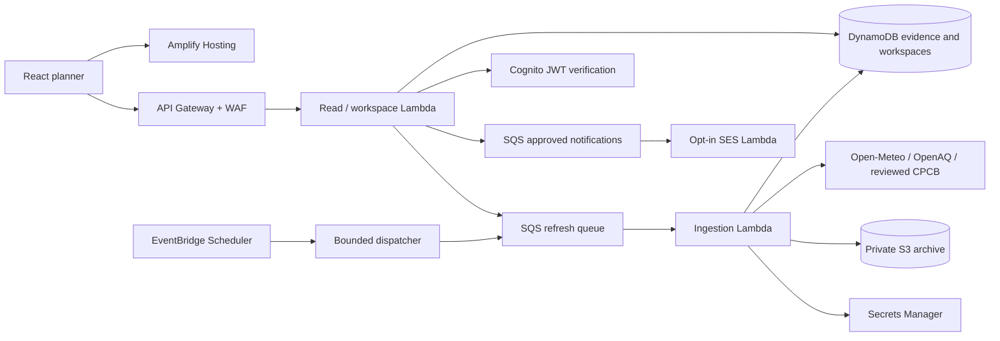

# Airday · India outdoor air planner

Airday turns regional pollution evidence into a recorded outdoor activity decision. Schools are the first demo story; families, workers and community groups can use the same planner. Forecasts, observations, personal rules and official guidance remain distinct.

**Active work, 10 October 2026:** complete the R0 foundations and verify all 16 R1/R2 features locally before AWS deployment. R3 work is paused and R4/R5 are deferred. The current acceptance ledger is [R0_R2_RELEASE_STATUS.md](R0_R2_RELEASE_STATUS.md); historical implementation notes below describe integrated code, not full release acceptance.

**Implementation status, 8 October 2026:** the local application, ingestion pipeline, optional workspace workflow and AWS deployment stack are implemented. Delhi's no-key API returned 72 real forecast points and the response was archived. Station integration, cloud deployment, Cognito sign-in and SES delivery need real account configuration and deployed verification. This is a bounded pilot implementation; national station coverage, measured forecast accuracy and enterprise availability are not established.

**Feature update, 9 October 2026:** the map's R1 browser implementation is integrated: quick-time finder, dated activity timeline and templates, review inbox, frozen-evidence CSV/print reports, readable source status and English/Hindi planning explanations. IndexedDB now owns transactional local planning data, with migration, version checks, session-only fallback and validated backup import. See [IMPLEMENTATION_R1.md](IMPLEMENTATION_R1.md) for the exact scope and outstanding checks. AWS deployment remains pending.

## Run locally

**Frontend UX update, 9 October 2026:** five task views share place/date/language context, stepped planning, alternative previews and frozen station/decision details. **R2 is integrated:** optional station map, five local saved areas, bounded retained-history API and trends, daily/weekly recaps, model concentration-time estimates, six pollutant views and period comparisons, private feedback and production offline reading. See [IMPLEMENTATION_R2.md](IMPLEMENTATION_R2.md) for exact bounds and [FRONTEND_UX_IMPLEMENTATION.md](FRONTEND_UX_IMPLEMENTATION.md) for the UX ledger. Browser review, live provider verification and AWS deployment remain required; later context/device bundles have separate gates.

Use Node 24 (or Node 22.18+) and pnpm.

```powershell
pnpm install
# Create .env only if it does not already exist; preserve existing keys.
if (-not (Test-Path .env)) { Copy-Item .env.example .env }
pnpm dev
```

Open [Airday locally](http://127.0.0.1:5174/). Vite proxies `/api` to the Node server at `127.0.0.1:3001`. Both bind to loopback. The local API persists evidence under the ignored `.airday-local/` directory and processes queued refreshes in the background. It never substitutes fixture air readings.

The first request can show **Retrieval queued**; the UI checks again after five seconds. Forecast and observation adapters run independently. An unavailable model can still leave observations visible. A failed refresh retains the earlier evidence and original timestamps.

City search and non-commercial forecasts work without a key. For station readings, save your OpenAQ key in the server-only `OPENAQ_API_KEY` setting in `.env`, then restart `pnpm dev`. Do not put keys in `VITE_` variables, source code, screenshots or chat. `pnpm preflight` reports presence without showing values.

## What works

- Indian city/town search and permission-based device location; no continuous tracking.
- PM2.5/PM10 chart, exact hourly table, units, dates, regional grid description and attribution.
- Separate nearby observations with station, distance, owner/provider, original measurement timestamp, averaging period and quality status when supplied.
- Explicit pending, forecast-only, observation-only, old/missing data, unconfigured provider, unknown metadata and paused ingestion states.
- Recurring activity editor, user review threshold, practical flexibility constraints and confirmation of an indoor option.
- Same-duration lower-forecast alternatives within the user's permitted time range. These compare model values and do not establish safe conditions.
- Reasoned decisions attached to the evidence shown when the editor opened; changed-evidence reminders, follow-through, JSON export and English/Hindi summary templates.
- Optional Cognito workspaces: role-based plan edits, proposals, approvals, atomic audit records, optimistic versions and opt-in approval email delivery.
- Shared persistence, refresh leases, global request budgets, retries, cooldowns, spatial observation indexing, prospective archives and resumable history reconciliation.
- Operator controls, backup/restore and coverage/evaluation tools. See [OPERATIONS.md](OPERATIONS.md).

Personal plans and decision history remain browser-local until explicitly submitted to a workspace. Quick activities remain local. Planning data is saved together in IndexedDB; location preference stays separate in localStorage. Saving failures show session-only status, retry and export options. Settings imports the versioned planning JSON with a preview and explicit merge/replace choice; conflicting history is rejected. Legacy bytes are preserved during migration. Browser data is origin-specific: use the same host and port, or export/import when switching between `localhost` and `127.0.0.1`. **Forget saved location** removes device coordinates from browser storage. Server demand retains a rounded 0.1° area for one day; exact GPS is not written into evidence records or passed to providers. Country checks for coordinates are bounding checks; city search uses the provider's `IN` country match.

## Sources and data limits

| Source                                                                                               | Integration                                                                   | Conditions                                                                                                                                                                                                        |
| ---------------------------------------------------------------------------------------------------- | ----------------------------------------------------------------------------- | ----------------------------------------------------------------------------------------------------------------------------------------------------------------------------------------------------------------- |
| [Open-Meteo Geocoding](https://open-meteo.com/en/docs/geocoding-api)                                 | `/v1/search`, country `IN`; GeoNames attribution                              | No key for non-commercial use; commercial customer endpoint supported.                                                                                                                                            |
| [Open-Meteo / CAMS Global](https://open-meteo.com/en/docs/air-quality-api)                           | `/v1/air-quality`, `cams_global`, PM2.5/PM10, Asia/Kolkata, three days        | Regional model, roughly 45 km and 3-hour source steps; hourly concentrations are not official Indian AQI or school measurements. Retrieval time is known; model issue time is not supplied by this integration.   |
| [OpenAQ v3](https://docs.openaq.org/api/operations/locations_get_v3_locations_get)                   | Locations with embedded sensors, location latest/flags, sensor hourly history | Key required. Verified concentration units, sensor IDs and periods are preserved; current Indian station coverage remains to be checked with the user's key.                                                      |
| [CPCB / data.gov.in](https://www.data.gov.in/resource/real-time-air-quality-index-various-locations) | Resource `3b01bcb8-0b14-4abf-b6f2-c1bfd384ba69`; bounded pagination           | Optional key. **Numeric display is disabled until official units, statistic, period and timestamp semantics are reviewed in `api/config/cpcb-contract.json`.** A key alone does not make ambiguous values usable. |
| [CAQM](https://caqm.nic.in/) / [Delhi Education](https://www.edudel.nic.in/)                         | Manually reviewed policy registry                                             | Empty by default, explicitly verification-needed. A published GRAP schedule is not an invoked order. Documents require scope, dates, source hash and review; checks expire after 24 hours.                        |

OpenAQ's free limit is [60/minute and 2,000/hour](https://docs.openaq.org/using-the-api/rate-limits). Open-Meteo's hosted [non-commercial access terms](https://open-meteo.com/en/pricing) have quotas and no uptime guarantee. Internal budgets sit below these limits and include retries. Keys are not rotated to evade limits. Source licensing must be reviewed before redistributing archived OpenAQ data; automatic S3 observation archival is off by default.

Provider disagreement is not resolved by averaging different readings. Comparison requires reviewed station identity, matching pollutant, units, statistic and period. Shared origin is explicitly labelled. Station searches are bounded and use a rounded area; a displayed station is selected from returned/indexed candidates, not a guarantee of the nearest monitor in the entire network.

## Architecture

See [ARCHITECTURE.md](ARCHITECTURE.md) and [IMPLEMENTATION_PLAN.md](IMPLEMENTATION_PLAN.md).



Default capacity is **20 active rounded areas and 20 OpenAQ stations**, one-hour forecast refresh and 15-minute monitor refresh, not unrestricted nationwide concurrency. Station, grid and quota caches are shared across workers. API demand within these bounds queues refresh work; reads never fetch air providers synchronously. Geocoding is a cached, bounded upstream call. SQS duplicates, provider errors and archive failures have separate handling.

## Checks

```powershell
pnpm test
pnpm lint
pnpm build
pnpm build:api
pnpm check:config
pnpm check:infra
pnpm check:security
pnpm audit
sam validate --lint --template-file template.yaml --region ap-south-1
pnpm benchmark:local
```

The offline suite uses labelled synthetic fixtures that production imports never reference. It covers data contracts, gaps, periods, dates, stale evidence, source/queue failures, leases, quotas, reconciliation, planning, roles, tenant isolation, audit/version conflicts and opt-in delivery. A passing dependency audit means no known advisories were reported, not that software has no vulnerabilities.

Rendered browser automation was rejected by the saved permission setting in this workspace. Mobile rendering, keyboard interaction, screen-reader use and 200% zoom still require manual review. Cloud permissions, Cognito/SES integration and deployed load/restore checks require the AWS account. See [RELEASE_STATUS.md](RELEASE_STATUS.md) for measured results and open gates.

## Deploy to AWS

Install AWS CLI v2 and SAM CLI. Sign in locally to an AWS CLI profile that can provision the services in `template.yaml`; no AWS passwords or access keys belong in this repository. Keep optional provider keys in `.env`; the deployment script installs them into Secrets Manager using a temporary file and removes it afterward. They are not CloudFormation parameters or build variables.

```powershell
# Complete the appropriate AWS login flow for your account, then:
.\scripts\deploy-aws.ps1 -Profile airday -Region ap-south-1
# Optional monitoring email and verified SES sender:
# .\scripts\deploy-aws.ps1 -Profile airday -AlertEmail <your-email> -NotificationSender <verified-sender>
```

The script checks local release gates, creates/reuses Amplify, deploys SAM, uploads keys, builds and uploads the frontend with restrictive security headers, and verifies the URL, API contract and Delhi cache warmup. It saves resource outputs in ignored `.airday-deploy.json`. Never label a forecast-only deployment as live station coverage. The code is ready for these steps; **no AWS resources were provisioned during this implementation**.

The plan's low-traffic cost envelope is approximately **$15–$35/month**, not a spending cap or current bill. WAF, monitoring, retention and traffic can affect charges. An optional account-wide $75 budget sends $20/$50/$75 notifications; alerts do not stop spending. The ingestion switch preserves cached reads. Review the account's actual pricing/credits and configure alerts before publishing.

## API surface

Public: `GET /api/health`, `/api/config`, `/api/search?q=Delhi`, `/api/dashboard?lat=28.6139&lon=77.209&city=New%20Delhi&state=Delhi&date=YYYY-MM-DD`. Dates cover today and the next two days in IST. Device lookup adds `mode=coordinates`.

Authenticated: `GET /api/workspace`, `PUT /api/workspace/plan`, `POST /api/workspace/decisions`, `POST /api/workspace/decisions/{id}/approve`, `PUT /api/workspace/decisions/{id}/follow-through`, `PUT /api/workspace/notifications`. Workspace identity comes from verified Cognito access tokens and server-owned membership, never a browser tenant ID.

The [demo script](DEMO.md) shows one real planning decision, evidence limitations and the actual AWS role in three minutes. Interviews, maintained local sensors, prospective accuracy validation and real operational ownership remain pilot work; they cannot be completed by scaffolding software or supplying more API keys.
